# Постановка задачи

## Математическая модель

Рассматривается начально-краевая задача для двумерного нестационарного уравнения теплопроводности в прямоугольной области

$$
\Omega = \{(x,y)\mid 0\le x\le L_x,\ 0\le y\le L_y\},\qquad t\in[t_0,t_1].
$$

Модель имеет вид

$$
\boxed{
\frac{\partial u}{\partial t}
=a^2\left(\frac{\partial^2u}{\partial x^2}
+\frac{\partial^2u}{\partial y^2}\right)+f(t,x,y)
}
\tag{1}
$$

Здесь $u(t,x,y)$ — искомое поле температуры, $a^2$ — коэффициент диффузии в выбранной записи уравнения, $f$ — функция источника. Обозначение $a$ взято непосредственно из программы; это важно, поскольку в расчётной схеме коэффициент возводится в квадрат.

## Параметры исходного варианта

Исходный вариант задаётся структурой `Config` в [`sequence.cpp`](../sequence.cpp). Во всех версиях массивы температур и основные вещественные вычисления используют тип `double`.

| Обозначение | Ключ | Значение в `sequence.cpp` | Смысл |
|:--|:--|--:|:--|
| $t_0$ | `--t0` | 0 | Начальный момент времени |
| $t_1$ | `--t1` | 10 | Конечный момент времени |
| $L_x$ | `--Lx` | 2,0 | Протяжённость области по $x$ |
| $L_y$ | `--Ly` | 1,0 | Протяжённость области по $y$ |
| $N_x$ | `--Nx` | 100 | Число сеточных узлов по $x$ |
| $N_y$ | `--Ny` | 50 | Число сеточных узлов по $y$ |
| $N$ | `--N` | 1000 | Число временных шагов |
| $a$ | `--a` | 0,1 | Параметр при операторе Лапласа ($a^2$) |
| — | `--debug` | 0 | Выбор режима верификации |

Фрагмент объявления параметров:

```cpp
struct Config {
  double t0 = 0, t1 = 10;
  double Lx = 2.0, Ly = 1.0;
  int Nx = 100, Ny = 50, N = 1000;
  double a = 0.1;
  bool debug = false;
};
```

## Начальные и граничные условия

Для задачи проверки начальное условие выбрано из известной аналитической функции:

$$
u(t_0,x,y)=(1+t_0)
\cos\frac{\pi x}{L_x}\sin\frac{\pi y}{L_y}.
\tag{2}
$$

На вертикальных сторонах области заданы однородные условия **Неймана**:

$$
\left.\frac{\partial u}{\partial x}\right|_{x=0}=0,
\qquad
\left.\frac{\partial u}{\partial x}\right|_{x=L_x}=0.
\tag{3}
$$

На горизонтальных сторонах заданы однородные условия **Дирихле**:

$$
u(t,x,0)=0,\qquad u(t,x,L_y)=0.
\tag{4}
$$

В `relax()` значения крайних строк по $y$ явно не пересчитываются: оба выделенных массива первоначально заполнены нулями, внутренние циклы исключают $j=0$ и $j=N_y-1$, а обмен указателей сохраняет нулевые граничные строки. По $x$ значения границы вычисляются на каждом временном слое с использованием трёх соседних узлов.

Два режима различаются правой частью (1): при `--debug 1` используется рассчитанная функция источника; в режиме производительности $f=0$. Поэтому результаты этих режимов относятся к разным начально-краевым задачам при одинаковых начальных и граничных данных.

# Аналитическое решение

## Функция с заранее известным решением

Для проверки выбрана функция

$$
\boxed{
u_{\mathrm{ex}}(t,x,y)
=(1+t)\cos\frac{\pi x}{L_x}\sin\frac{\pi y}{L_y}
}
\tag{5}
$$

Её реализация в `u_exact()` совпадает с формулой:

```cpp
double u_exact(double t, double x, double y,
               double Lx, double Ly) {
  return (1.0 + t) *
         cos(x * M_PI / Lx) *
         sin(y * M_PI / Ly);
}
```

## Метод подбора функции источника

Дифференцирование (5) даёт

$$
u_t=\cos\frac{\pi x}{L_x}\sin\frac{\pi y}{L_y},
$$

$$
u_{xx}=-(1+t)\frac{\pi^2}{L_x^2}
\cos\frac{\pi x}{L_x}\sin\frac{\pi y}{L_y},
$$

$$
u_{yy}=-(1+t)\frac{\pi^2}{L_y^2}
\cos\frac{\pi x}{L_x}\sin\frac{\pi y}{L_y}.
$$

Из (1) следует

$$
f=u_t-a^2(u_{xx}+u_{yy}),
$$

откуда

$$
\boxed{
f(t,x,y)=
\left[1+a^2(1+t)\pi^2
\left(\frac1{L_x^2}+\frac1{L_y^2}\right)\right]
\cos\frac{\pi x}{L_x}\sin\frac{\pi y}{L_y}
}
\tag{6}
$$

Это **метод изготовленного решения** (method of manufactured solutions): сначала задаётся точная функция, затем по уравнению вычисляется источник, при котором она является решением. В исходном файле (6) реализована функцией `f()`; в оптимизированных версиях она вызывается только в ветке отладки.

Проверка граничных условий: производная `u_x` содержит множитель `\sin(\pi x/L_x)` и обращается в ноль при `x=0,L_x`; сама функция $u$ содержит `\sin(\pi y/L_y)` и обращается в ноль при `y=0,L_y`. Начальное условие (2) выполняется тождественно.

Для **режима $f=0$** формула (5) уже не является точным решением. Для заданных начальных и однородных смешанных граничных условий точным решением однородного уравнения будет

$$
u_0(t,x,y)=(1+t_0)
e^{-a^2\pi^2(1/L_x^2+1/L_y^2)(t-t_0)}
\cos\frac{\pi x}{L_x}\sin\frac{\pi y}{L_y}.
\tag{7}
$$

Однако существующая функция `verify()` сравнивает результат именно с (5); поэтому её следует вызывать для `--debug 1`, как это и делается в программе.

# Численное решение

## Сетка и аппроксимация производных

Равномерная пространственно-временная сетка определяется как

$$
x_i=ih_x,\quad h_x=\frac{L_x}{N_x-1},\quad i=0,\ldots,N_x-1,
$$

$$
y_j=jh_y,\quad h_y=\frac{L_y}{N_y-1},\quad j=0,\ldots,N_y-1,
$$

$$
t_n=t_0+n\tau,\quad \tau=\frac{t_1-t_0}{N},\quad n=0,\ldots,N.
\tag{8}
$$

Введём `U^n_{i,j}\approx u(t_n,x_i,y_j)`. Для производной по времени используется прямая разность, а для вторых пространственных производных — центральные:

$$
u_t\approx\frac{U^{n+1}_{i,j}-U^n_{i,j}}{\tau},
$$

$$
u_{xx}\approx
\frac{U^n_{i+1,j}-2U^n_{i,j}+U^n_{i-1,j}}{h_x^2},
\qquad
u_{yy}\approx
\frac{U^n_{i,j+1}-2U^n_{i,j}+U^n_{i,j-1}}{h_y^2}.
\tag{9}
$$

Подстановка (9) в (1) даёт явную пятиточечную схему:

$$
\boxed{\begin{aligned}
U^{n+1}_{i,j}={}&U^n_{i,j}
+r_x(U^n_{i+1,j}-2U^n_{i,j}+U^n_{i-1,j})\\
&+r_y(U^n_{i,j+1}-2U^n_{i,j}+U^n_{i,j-1})
+\tau f(t_n,x_i,y_j),
\end{aligned}}
\tag{10}
$$

где

$$
r_x=\frac{a^2\tau}{h_x^2},\qquad
r_y=\frac{a^2\tau}{h_y^2}.
\tag{11}
$$

При достаточной гладкости решения локальная погрешность аппроксимации соответствует первому порядку по времени и второму по пространству: $O(\tau+h_x^2+h_y^2)$.

## Схема в исходном коде

Двумерный массив хранится линейно, в порядке строк:

$$
k=jN_x+i,\qquad U^n_{i,j}\longleftrightarrow U[k].
\tag{12}
$$

Это даёт последовательный доступ по `i` во внутреннем циклSе, что важно для кэша и векторизации. Вычислительное ядро в [`sequence.cpp`](../sequence.cpp) имеет вид:

```cpp
for (int j = 1; j < Ny - 1; j++) {
  for (int i = 1; i < Nx - 1; i++) {
    int k = j * Nx + i;
    U_next[k] =
        U[k]
      + rx * (U[k + 1] - 2 * U[k] + U[k - 1])
      + ry * (U[k + Nx] - 2 * U[k] + U[k - Nx])
      + tau * f(tn, i * hx, j * hy, a, Lx, Ly);
  }
}
```

## Граничные условия и обмен буферов

На $x=0$ аппроксимация нулевой производной односторонней разностью второго порядка:

$$
\frac{-3U^{n+1}_{0,j}+4U^{n+1}_{1,j}-U^{n+1}_{2,j}}{2h_x}=0.
$$

Следовательно,

$$
U^{n+1}_{0,j}=\frac{4U^{n+1}_{1,j}-U^{n+1}_{2,j}}3.
\tag{13}
$$

Аналогично на правой границе:

$$
U^{n+1}_{N_x-1,j}=
\frac{4U^{n+1}_{N_x-2,j}-U^{n+1}_{N_x-3,j}}3.
\tag{14}
$$

Именно формулы (13)–(14) реализованы в граничном цикле `relax()`. Для каждого временного слоя используются два массива `U` и $U_next$: все узлы нового слоя вычисляются из *неизменяемого* старого, после чего выполняется `swap(U, U_next)`. Это устраняет зависимости запись–чтение между внутренними узлами одного слоя и делает возможным распараллеливание по строкам.

## Условие устойчивости и допустимые параметры

Для стандартной явной схемы теплопроводности необходимо

$$
\boxed{r_x+r_y\le\frac12.}
\tag{15}
$$

Подставляя (8) и (11), получим

$$
\boxed{
N\ge N_{\min}=
2a^2(t_1-t_0)\left(\frac1{h_x^2}+\frac1{h_y^2}\right).
}
\tag{16}
$$

Для параметров исходного `sequence.cpp`:

$$
h_x=\frac2{99},\qquad
h_y=\frac1{49},\qquad
r_x=0.245025,\qquad
r_y=0.240100,
$$

$$
r_x+r_y=0.485125\le0.5,\qquad
N_{\min}=970.25,\qquad N=1000.
$$

Следовательно, параметры исходного варианта удовлетворяют необходимому ограничению устойчивости. Проверка (16) выполняется программой в `validate()` до выделения массивов и основного вычисления.

# Верификация

## Контроль результата

В режиме `--debug 1` включается источник (6), а после `relax()` вызывается `verify()`. В конечный момент $t_1$ вычисляется разность

$$
e_{i,j}=U^N_{i,j}-u_{\mathrm{ex}}(t_1,x_i,y_j).
\tag{17}
$$

Программа выводит две нормы:

$$
\|e\|_C=\max_{i,j}|e_{i,j}|,
\tag{18}
$$

$$
\|e\|_{\ell_2}=
\sqrt{\sum_{j=0}^{N_y-1}\sum_{i=0}^{N_x-1}e_{i,j}^2}.
\tag{19}
$$

**Замечание:** (19) — обычная евклидова норма вектора сеточных ошибок, *без* множителя $\sqrt{h_xh_y}$. Поэтому её численное значение зависит также от числа узлов; нельзя отождествлять её с интегральной нормой $L_2(\Omega)$.

Ключевой фрагмент функции [`verify()`](../sequence.cpp):

```cpp
double error_inf = 0.0;
double error_l2 = 0.0;
for (int j = 0; j < Ny; ++j) {
  for (int i = 0; i < Nx; ++i) {
    double exact = u_exact(t1, i * hx, j * hy, Lx, Ly);
    double error = abs(U[j * Nx + i] - exact);
    error_inf = max(error_inf, error);
    error_l2 += error * error;
  }
}
error_l2 = sqrt(error_l2);
```

## Проверка последовательной версии

Ниже приведены результаты **дополнительных локальных запусков** обновлённого `sequence.cpp` на `double`, собранного `g++ 14.2.0 -O2`, с `t_0=0`, $t_1=10$, `L_x=2`, `L_y=1`, `a=0.1`, `--debug 1`. Эти значения **не получены** из архивных производительных тестов репозитория.

| Сетка `N_x\times N_y` | Шагов $N$ | $\|e\|_C$ | $\|e\|_{\ell_2}$ |
|:--|--:|--:|--:|
| `50\times25` | 500 | 0,00579924 | 0,103473 |
| `100\times50` | 1000 | 0,00141606 | 0,0503893 |
| `150\times75` | 2250 | 0,000625213 | 0,0333003 |

При сгущении сетки максимальная погрешность уменьшается, что согласуется с ожидаемой сходимостью схемы. Для строгого определения наблюдаемого порядка необходимо проводить отдельную серию расчётов с контролируемым соотношением $\tau$ и `h_x,h_y`. В оптимизированных программах дополнительно выводится `Checksum = \sum_k U[k]^2`; он полезен для обнаружения грубых расхождений между реализациями, но не заменяет проверки норм (18)–(19).

# Программная реализация

## Организация исходных файлов

В проекте реализованы:

| Файл | Роль |
|:--|:--|
| [`sequence.cpp`](../sequence.cpp) | Начальная последовательная схема и интерфейс командной строки |
| [`loop/sequence.loop.cpp`](../loop/sequence.loop.cpp) | Последовательная версия с ручной раскруткой циклов |
| [`openmp/openmp.loop.cpp`](../openmp/openmp.loop.cpp) | Многопоточная OpenMP-версия |
| [`pthread/pthread.loop.cpp`](../pthread/pthread.loop.cpp) | Многопоточная реализация на POSIX Threads |

Общий программный маршрут: чтение параметров → `parse()` → `validate()` → выделение двух буферов → `relax()` → при необходимости `verify()` → освобождение памяти.

## Справка `help()` и параметры

Функция `help()` печатает допустимые аргументы. Без аргументов или при первом аргументе `-h`/`--help` программа выводит справку и завершается; `--help` в середине списка `parse()` как самостоятельный флаг не обрабатывает.

| Аргумент | Варианты | Назначение |
|:--|:--|:--|
| `--t0`, `--t1` | Вещественные | Границы временного интервала |
| `--Lx`, `--Ly` | Положительные вещественные | Размеры области |
| `--Nx`, `--Ny` | Целые | Размер пространственной сетки |
| `--N` | Целое | Число временных шагов |
| `--a` | Положительное вещественное | Параметр $a$ |
| `--debug` | `0` или `1` | Выбор режима |
| `--loop` | `1,2,4,8` | Коэффициент ручной раскрутки (оптимизированные версии) |
| `--threads` | Положительное целое | Число нитей (Pthreads; OpenMP задаётся через окружение) |

Не все ключи поддерживаются каждой версией: `--loop` отсутствует в исходной `sequence.cpp`, `--threads` является аргументом Pthreads-версии.

Пример проверки точности:

```bash
./sequence --debug 1 --Nx 100 --Ny 50 --N 1000 \
  --t0 0 --t1 10 --Lx 2 --Ly 1 --a 0.1
```

## Разбор аргументов `parse()`

Функция `parse(int argc, char* argv[], Config& cfg)` последовательно считывает пары «ключ — значение», преобразуя вещественные параметры посредством `std::stod()`, а целочисленные — `std::stoi()`. Ранее использовавшийся `float` заменён на `double` и в параметрах, и в расчётных буферах.

```cpp
if (arg == "--t0")
  cfg.t0 = stod(value);
else if (arg == "--N")
  cfg.N = stoi(value);
else if (arg == "--debug")
  cfg.debug = (value == "1");
else
  throw invalid_argument("Неизвестный аргумент: " + arg);
```

Отсутствующее значение и неизвестный ключ приводят к исключению. Отладочный режим включается именно парой `--debug 1`, а не одиночным флагом `--debug`.

## Проверка допустимости `validate()`

Функция `validate()` отвергает невалидный интервал времени, неположительные геометрические параметры и $a$, $N\le0$, $N_x<4$, $N_y<3$. Для режима измерений дополнительно требуется $N\ge2$: первый временной шаг исключён из замера. После базовых проверок вычисляется $N_{\min}$ из (16); при нарушении условия устойчивости программа сообщает размеры сетки, $N$ и $N_{\min}$ и завершается.

```cpp
double hx = Lx / (Nx - 1);
double hy = Ly / (Ny - 1);
double N_min = 2 * a * a * (t1 - t0) *
               (1 / (hx * hx) + 1 / (hy * hy));
if (N < N_min) {
  cout << "Условие устойчивости нарушено\n";
  exit(EXIT_FAILURE);
}
```

Эта проверка относится к **конкретным параметрам запуска**, а не просто к параметрам по умолчанию. В производительных CSV сохранены сетка, число шагов и $t_1$, но не сохранён параметр $a$, поэтому по самим CSV невозможно независимо восстановить проверку устойчивости всех архивных запусков.

## Режим отладки

В режиме `debug` выполняются дополнительные вычисления функции $f$ в каждом внутреннем узле и сравнение численного результата с формулой (5). Поэтому время такого запуска нельзя непосредственно сопоставлять с режимом производительности. Основная цель — математическая корректность, включая влияние шага сетки и граничных условий.

## Режим производительности и MLUPS

В производительном режиме $f=0$, а измеряется только часть алгоритма после первого «прогревочного» временного шага. Метрика **MLUPS** (`Million Lattice Updates Per Second`) — миллионы обновлений внутренних узлов в секунду:

$$
\boxed{
\mathrm{MLUPS}=
\frac{(N-1)(N_x-2)(N_y-2)}
{10^6\,T_{\mathrm{measure}}}
}.
\tag{20}
$$

Первый шаг исключён из числителя и из времени измерения. Инициализация сетки и выделение памяти не входят в основной тайминг. Тем самым `T_{\mathrm{measure}}` — не полное время запуска программы с учётом старта и освобождения ресурсов.

Для прямого сопоставления разных чисел шагов удобно использовать нормированное время одного обновления:

$$
t_{\mathrm{update}}[\mathrm{ns}]
=\frac{1000}{\mathrm{MLUPS}}.
\tag{21}
$$

# Оптимизация последовательного алгоритма

## Исходный цикл и локальность памяти

Основная вычислительная работа состоит в применении пятиточечного шаблона ко всем внутренним узлам на каждом временном слое. Выбранный порядок `j` — внешний, `i` — внутренний обеспечивает последовательный доступ к памяти в направлении $x$.

В файле [`loop/sequence.loop.cpp`](../loop/sequence.loop.cpp) вычисление одного узла вынесено в короткую встраиваемую функцию:

```cpp
inline void update(const double *U, double *U_next,
                   int i, int j, int Nx, double rx, double ry) {
  int k = j * Nx + i;
  U_next[k] = U[k]
    + rx * (U[k + 1] - 2 * U[k] + U[k - 1])
    + ry * (U[k - Nx] - 2 * U[k] + U[k + Nx]);
}
```

В режиме измерений эта версия не вызывает тригонометрические функции при обновлении внутренних узлов; это важно при сравнении с начальной `sequence.cpp`.

## Ручная раскрутка циклов

Поддерживаются коэффициенты `q\in\{1,2,4,8\}` через `--loop q`. При $q=4$ одна итерация внутреннего цикла выполняет обновление четырёх последовательных узлов:

```cpp
int i = 1;
for (; i + 3 < Nx - 1; i += 4) {
  update(U, U_next, i,     j, Nx, rx, ry);
  update(U, U_next, i + 1, j, Nx, rx, ry);
  update(U, U_next, i + 2, j, Nx, rx, ry);
  update(U, U_next, i + 3, j, Nx, rx, ry);
}
for (; i < Nx - 1; ++i) {
  update(U, U_next, i, j, Nx, rx, ry);
}
```

Последний цикл корректно обрабатывает остаток, если число внутренних столбцов не кратно коэффициенту раскрутки. Раскрутка сокращает число проверок условия цикла и может улучшать планирование инструкций, но сама по себе **не гарантирует** ускорения: компилятор уже выполняет собственную оптимизацию и векторизацию, а увеличение размера тела цикла может ухудшать характеристики.

## Влияние оптимизаций компилятора

Испытаны пять профилей:

| Профиль в данных | Флаги компилятора |
|:--|:--|
| `O2` | `-O2` |
| `O3` | `-O3` |
| `native` | `-O3 -march=skylake-avx512` |
| `unroll` | `-O3 -march=skylake-avx512 -funroll-loops` |
| `novec` | `-O3 -march=skylake-avx512 -fno-tree-vectorize` |

Изменения инструкционного набора (`-march=skylake-avx512`) допустимы только на поддерживающем его оборудовании. Профили `unroll` и `novec` позволяют отдельно исследовать влияние автоматической раскрутки и векторизации.

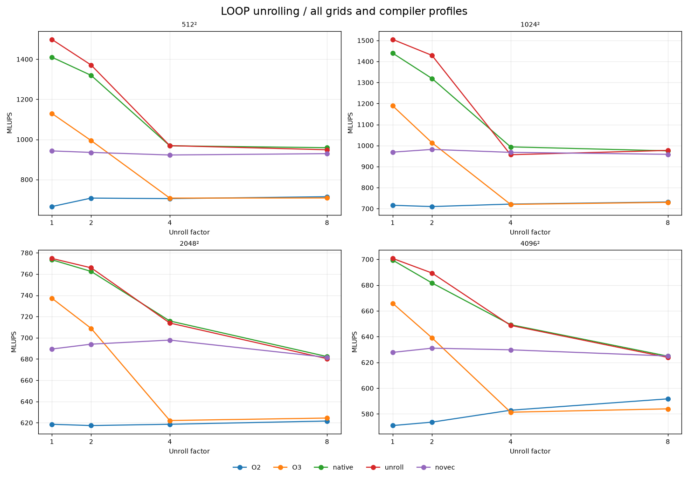{width=92%}

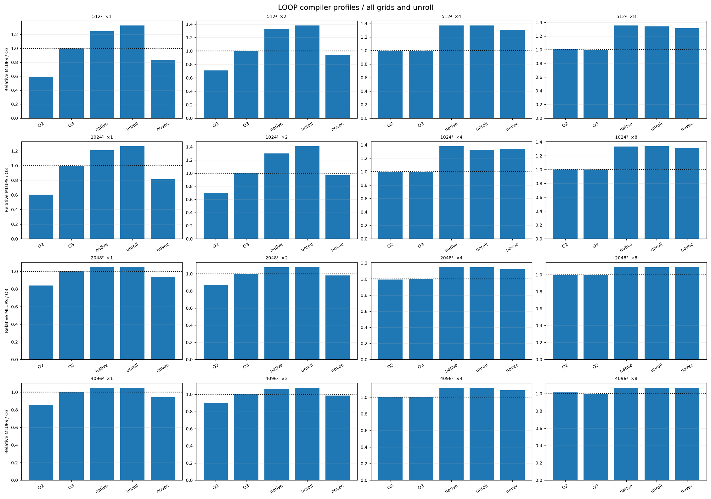{width=92%}

Например, на сетке $512^2$ при профиле `-O3` и одном потоке результат $q=1$ составляет **1129,56 MLUPS**, тогда как $q=4$ — **707,25 MLUPS**. Следовательно, увеличение $q$ нельзя считать универсально выигрышным. По полному набору `summary.csv` лучшие параметры могут различаться для каждой сетки и реализации.

# Параллельные реализации

## Независимость вычислений и принцип разбиения

Из (10) видно, что $U^{n+1}_{i,j}$ зависит только от `U^n`, а не от соседних значений `U^{n+1}`. Следовательно, внутренние узлы *одного* временного слоя можно вычислять одновременно. При этом между соседними временными шагами необходим барьер: все потоки должны закончить запись нового слоя до обмена буферов и начала следующего шага.

В обеих реализациях распределяются **строки** `j=1,\ldots,N_y-2`. Обновление внутренних узлов и соответствующих вертикальных границ выполняется тем же потоком, который обрабатывает строку. Общая память содержит два массива `double`; дополнительных обменов данных между потоками не требуется.

## OpenMP

В [`openmp/openmp.loop.cpp`](../openmp/openmp.loop.cpp) параллельная область создаётся **один раз** на все временные шаги, что уменьшает накладные расходы относительно создания новой команды нитей на каждой итерации. Строки распределяются статически:

```cpp
#pragma omp parallel
for (int n = 0; n < N; ++n) {
#pragma omp for schedule(static)
  for (int j = 1; j < Ny - 1; ++j) {
    // Обновление внутренних узлов строки j.
    // Затем обработка границ x=0 и x=Lx для той же строки.
  }

#pragma omp single
  {
    swap(U, U_next);
  }
}
```

Листинг схематически сокращён: в настоящем файле внутри итерации по `n` есть ветви для `debug` и четырёх значений `loop`. **Семантика синхронизации** определяется реальными директивами: в конце `omp for` без `nowait` выполняется неявный барьер; `omp single` обеспечивает однократный обмен указателей и завершается неявным барьером, прежде чем потоки переходят к следующему временному шагу.

Число потоков задаётся средой OpenMP, например:

```bash
OMP_NUM_THREADS=8 OMP_PROC_BIND=true OMP_PLACES=cores \
./heat_omp --Nx 100 --Ny 50 --N 1000 --a 0.1 --Lx 2 --Ly 1 \
  --loop 4 --debug 0
```

При измерениях следует фиксировать размещение нитей, поскольку миграция между ядрами и NUMA-эффекты могут влиять на время выполнения.

## Pthreads

В [`pthread/pthread.loop.cpp`](../pthread/pthread.loop.cpp) потоки создаются явными вызовами `pthread_create()`. Каждый поток получает диапазон внутренних строк:

$$
j_{\mathrm{start}}(p)=1+\left\lfloor
\frac{(N_y-2)p}{P}
\right\rfloor,\qquad
j_{\mathrm{stop}}(p)=1+\left\lfloor
\frac{(N_y-2)(p+1)}P
\right\rfloor.
\tag{22}
$$

Это разбиение покрывает все внутренние строки без пересечений, даже если `N_y-2` не делится на $P$:

```cpp
args[i].j_start = 1 + (Ny - 2) * i / num_threads;
args[i].j_stop =
    1 + (Ny - 2) * (i + 1) / num_threads;
args[i].data = &data;
pthread_create(&threads[i], NULL, worker, &args[i]);
```

Для синхронизации реализован собственный **древовидный барьер на POSIX-семафорах** (`sem_wait/sem_post`): каждый поток ожидает завершения дочерних потоков в бинарном дереве, затем сигнализирует родителю; поток с номером 0 после сбора всех сигналов меняет местами указатели и распространяет разрешение на следующий временной шаг обратно вниз по дереву. Такая схема выполняет сбор и рассылку по дереву глубины `O(\log P)`, хотя фактическое время зависит от накладных расходов системных семафоров.

Ключевой фрагмент `barrier()`:

```cpp
int left = 2 * thread_num + 1;
int right = 2 * thread_num + 2;

if (left < num_threads)
  sem_wait(&b->sem[thread_num]);
if (right < num_threads)
  sem_wait(&b->sem[thread_num]);

if (thread_num == 0)
  swap(data->U, data->U_next);
else {
  int parent = (thread_num - 1) / 2;
  sem_post(&b->sem[parent]);
  sem_wait(&b->sem[thread_num]);
}

if (left < num_threads) sem_post(&b->sem[left]);
if (right < num_threads) sem_post(&b->sem[right]);
```

После выполнения рабочих циклов вызываются `pthread_join()` и освобождение семафоров. Число потоков задаётся аргументом `--threads`:

```bash
./heat_pthread --Nx 100 --Ny 50 --N 1000 --a 0.1 \
  --Lx 2 --Ly 1 --loop 4 --threads 8 --debug 0
```

## Сопоставление реализаций и контроль корректности

OpenMP реализует распределение итераций и барьеры средствами компилятора/рантайма; Pthreads требует собственных структур аргументов, создания потоков и синхронизации. Оба варианта используют общие массивы без копирования внутренних подобластей.

Корректность параллельной реализации требует, чтобы поток не читал новый слой, пока другие потоки его записывают; чтобы обмен буферов выполнялся единожды; и чтобы два потока не обновляли одну строку. В обоих исходных файлах эти требования обеспечиваются распределением строк и барьером между шагами. Тем не менее отдельного приложенного протокола динамической проверки гонок (`ThreadSanitizer`, `Helgrind` и т. п.) в репозитории нет; наличие корректной структуры алгоритма не следует выдавать за результат такого тестирования.

# Исследование производительности

## Экспериментальная база и методика

Использованы **реальные** данные репозитория:

- [`loop/results/summary.csv`](../loop/results/summary.csv) — последовательная версия;
- [`openmp/results/summary.csv`](../openmp/results/summary.csv) — OpenMP;
- [`pthread/results/summary.csv`](../pthread/results/summary.csv) — Pthreads;
- [`comparison_summary.csv`](../comparison_summary.csv) — отобранные сопоставимые конфигурации;
- [`RESULTS.md`](../RESULTS.md) и `*/results/metadata.json` — описание экспериментов и происхождения данных.

Измерения выполнены на сетках $512^2$, $1024^2$, $2048^2$, $4096^2$; для коэффициентов раскрутки `q=1,2,4,8`; с пятью профилями компиляции. Параллельные версии измерялись при `P=1,2,4,8,16,18,36` нитях. Для каждой конфигурации сохранено **пять запусков**; в `summary.csv` приведены медиана времени, медианная производительность, минимум, максимум и стандартное отклонение. Всего: `400+2800+2800=6000` индивидуальных измерений и `80+560+560=1200` конфигураций.

Для сеток `512^2,1024^2,2048^2,4096^2` последовательная/Pthreads версии использовали соответственно `N=10000,2000,800,250` шагов, а OpenMP — `N=20000,4000,1600,500` шагов. Во всех соответствующих строках `summary.csv` указано $t_1=0.001$. В файлах метаданных указаны Slurm-задания `18477` (loop), `18478/18488` (OpenMP) и `18483` (Pthreads). Повторный запуск OpenMP с $q=1$ связан с заданием `18488`.

**Методологическое ограничение:** число временных шагов OpenMP вдвое больше, поэтому **сырое время `median_time_s` разных реализаций нельзя сравнивать напрямую**. Для межреализационного сравнения используются MLUPS и $t_{\mathrm{update}}$, нормированные по объёму вычислений. Ускорение многопоточного варианта определяется относительно *той же реализации* на одной нити. Сведения о точной модели процессора, его частоте и значении $a$ для архивных запусков в доступных компактных метаданных отсутствуют; не следует подменять их догадками.

## Время одного обновления

Основной график `figures/time.png` показывает **нормированное время на узел**, а не исходное время всего запуска. Такое представление позволяет сравнивать конфигурации при разном $N$.

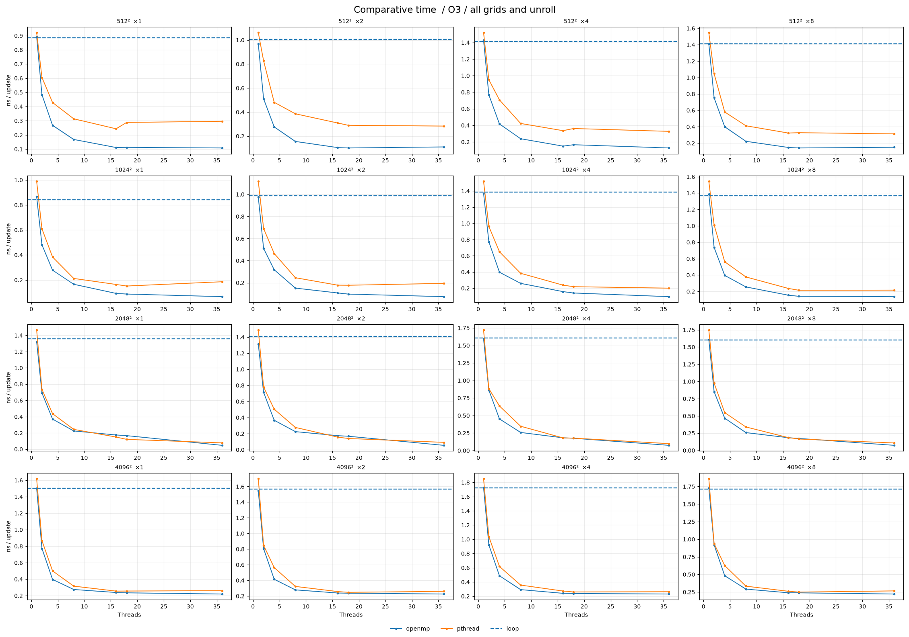{width=95%}

По смыслу (21) меньшие значения соответствуют более высокой производительности. На крупных сетках влияние кэш-памяти и пропускной способности ОЗУ становится существеннее; многопоточная реализация может перестать масштабироваться линейно.

## Производительность MLUPS: контролируемое сравнение

Следующая таблица взята из [`comparison_summary.csv`](../comparison_summary.csv) для профиля **`-O3`, $q=4$**. Для обоих многопоточных вариантов выбрано $P=36$. Здесь показатели выражают скорость полезных обновлений и потому допускают сравнение при разном числе временных шагов.

| Сетка | Послед. MLUPS | OpenMP, 36 нитей MLUPS | Pthreads, 36 нитей MLUPS | OpenMP / послед. | Pthreads / послед. |
|--:|--:|--:|--:|--:|--:|
| $512^2$ | 707,25 | 7878,50 | 3055,38 | 11,14 | 4,32 |
| $1024^2$ | 720,06 | 10473,36 | 4991,57 | 14,55 | 6,93 |
| $2048^2$ | 622,05 | 13459,67 | 10168,17 | 21,64 | 16,35 |
| $4096^2$ | 581,32 | 4330,76 | 3798,77 | 7,45 | 6,53 |

Здесь отношение последней пары столбцов является **отношением производительностей при фиксированных `-O3` и $q=4$**, а не абсолютным ускорением относительно наиболее быстрой последовательной конфигурации, найденной во всём переборе профилей. Такое уточнение существенно: для отдельных сеток другие коэффициенты раскрутки и флаги компиляции дают последовательной программе больше MLUPS.

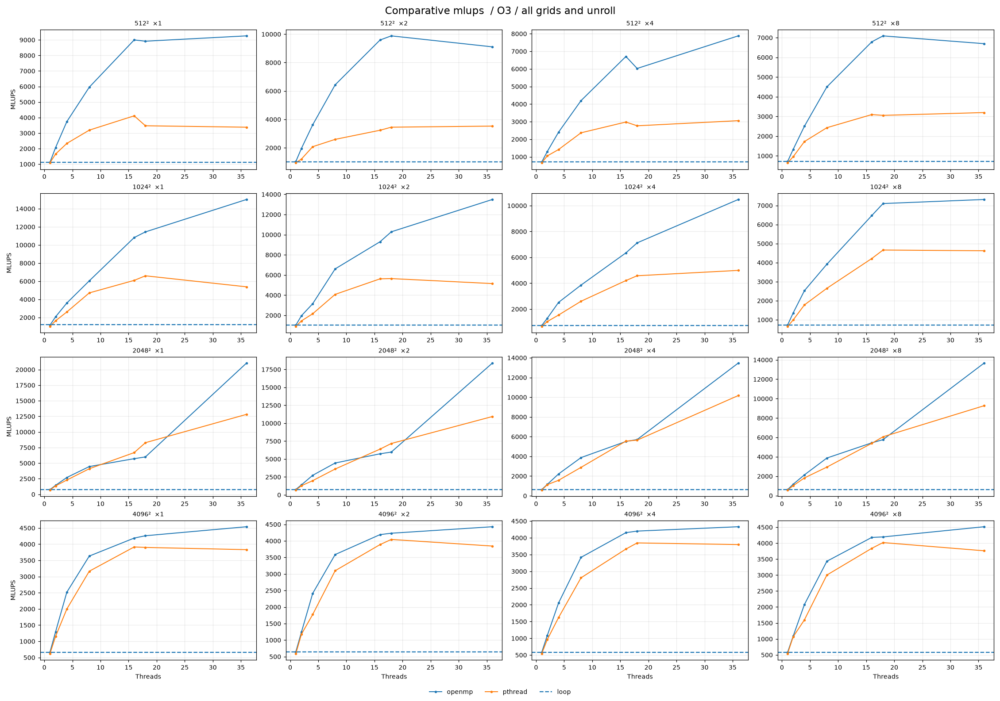{width=95%}

Среди четырёх сеток максимальная производительность OpenMP в фиксированном сравнении достигается при $2048^2$ (**13459,67 MLUPS**). При $4096^2$ она снижается до **4330,76 MLUPS**, что согласуется с возросшим рабочим набором данных и возможным ограничением пропускной способностью памяти. Два массива $4096^2$ из `double` занимают в совокупности `256` МиБ, без учёта прочих структур.

## Ускорение и эффективность

Для параллельной версии `m` определим ускорение на $P$ потоках при одинаковых сетке, профиле, раскрутке и числе шагов:

$$
S_m(P)=\frac{T_m(1)}{T_m(P)}
=\frac{\mathrm{MLUPS}_m(P)}{\mathrm{MLUPS}_m(1)}.
\tag{23}
$$

Эффективность использования потоков:

$$
E_m(P)=\frac{S_m(P)}{P}\cdot100\%.
\tag{24}
$$

Значения $S(P)$ и $E(P)$ определены отдельно для OpenMP и Pthreads, а не относительно одного потока другой реализации. Для последовательного `loop` формальная «эффективность распараллеливания» не рассматривается.

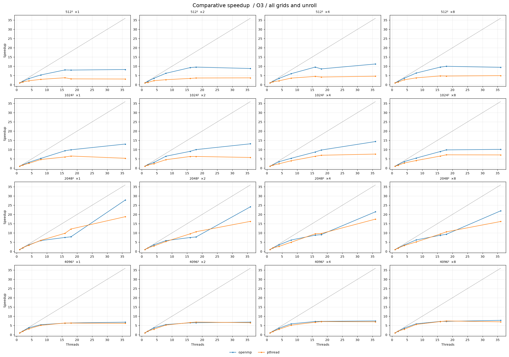{width=95%}

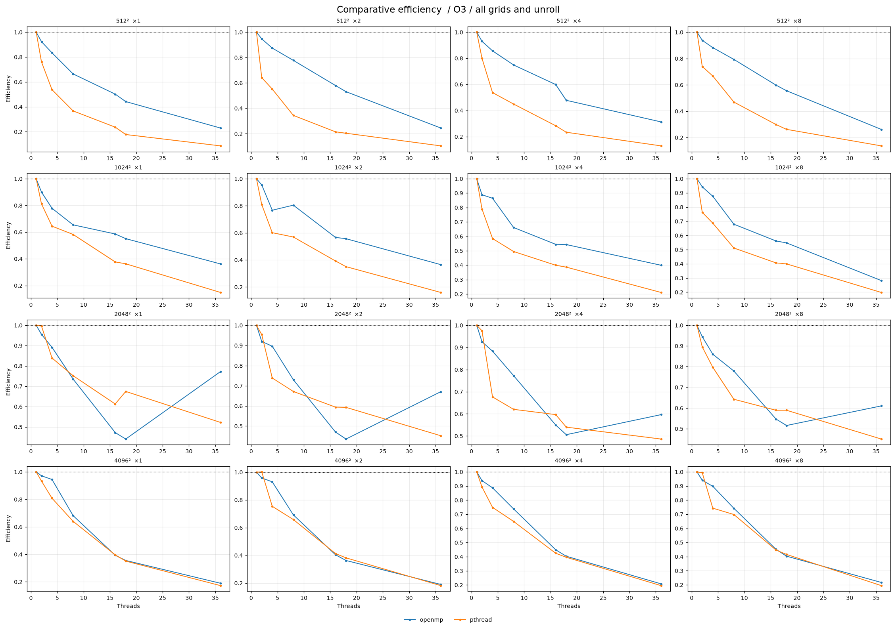{width=95%}

Для `-O3` и $q=4$ на **36 нитях** из соответствующих `summary.csv` получены приблизительные значения:

| Сетка | `S_{\mathrm{OMP}}(36)` | `E_{\mathrm{OMP}}(36)` | `S_{\mathrm{pth}}(36)` | `E_{\mathrm{pth}}(36)` |
|--:|--:|--:|--:|--:|
| $512^2$ | 11,25 | 31,3% | 4,64 | 12,9% |
| $1024^2$ | 14,38 | 39,9% | 7,59 | 21,1% |
| $2048^2$ | 21,47 | 59,6% | 17,50 | 48,6% |
| $4096^2$ | 7,49 | 20,8% | 7,04 | 19,5% |

Максимальный эффект для этой фиксированной серии получен при $2048^2$: OpenMP даёт ускорение примерно в `21,5` раза, а Pthreads — в `17,5` раза. При $4096^2$ эффективность падает: добавление нитей уже не обеспечивает пропорционального роста скорости.

## Раскрутка и масштабируемость параллельных вариантов

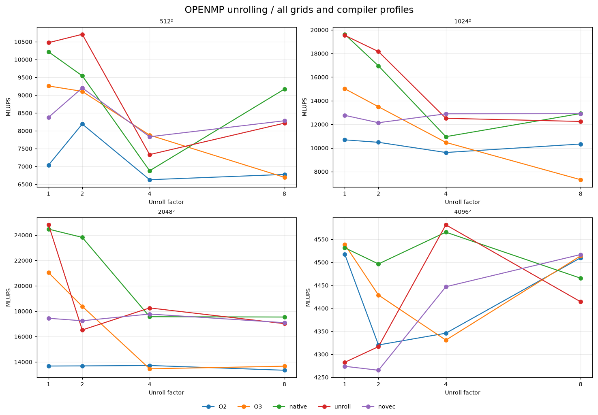{width=92%}

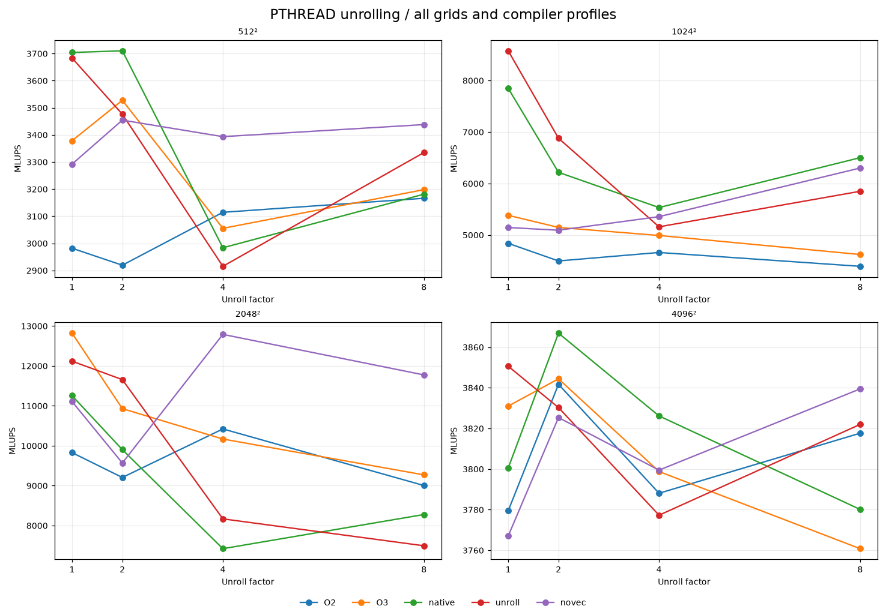{width=92%}

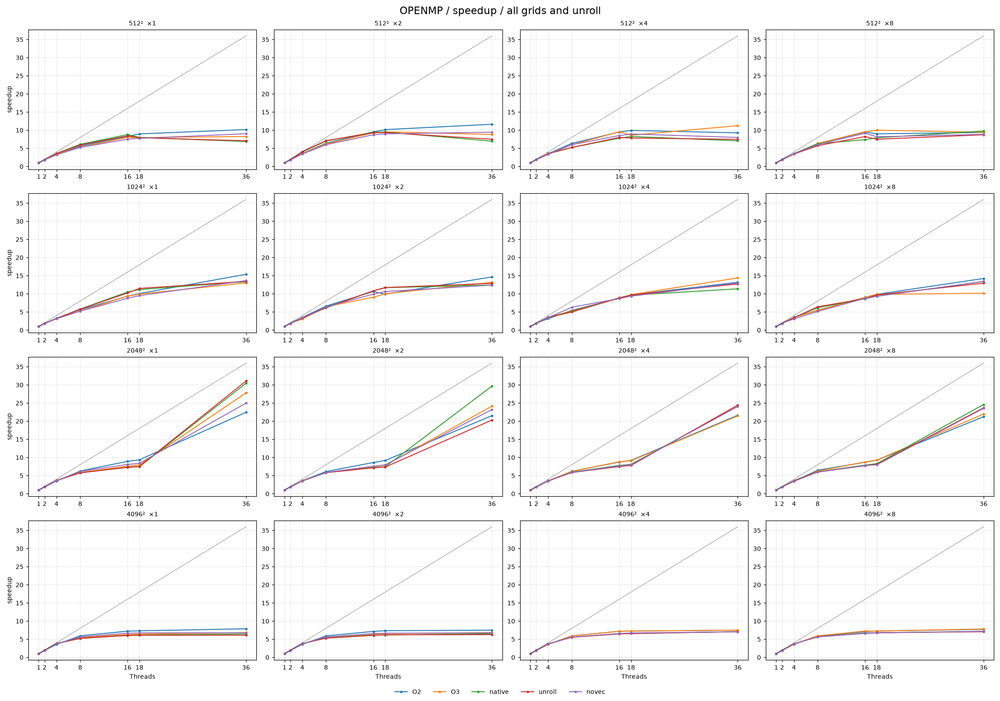{width=92%}

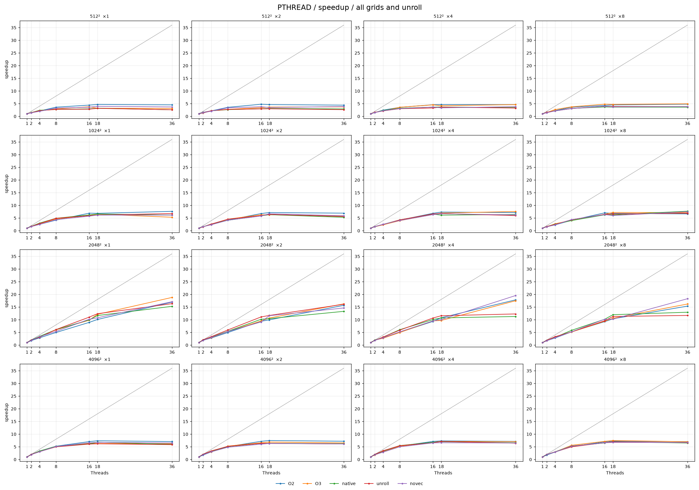{width=92%}

Эти графики демонстрируют, что коэффициент раскрутки, оптимизация компилятора и число потоков следует настраивать **совместно**. Так, при $512^2$ лучший зафиксированный OpenMP-результат во всём `summary.csv` равен примерно **13357 MLUPS** (профиль `unroll`, $q=2$, 18 нитей); при $2048^2$ — **24810 MLUPS** (профиль `unroll`, $q=1$, 36 нитей). Для Pthreads максимум при $2048^2$ равен примерно **12821 MLUPS** (`O3`, $q=1$, 36 нитей). Это экстремумы *разных* конфигураций; сравнение следует помечать как подбор лучших параметров, а не как контроль одного фактора.

## Влияние компилятора

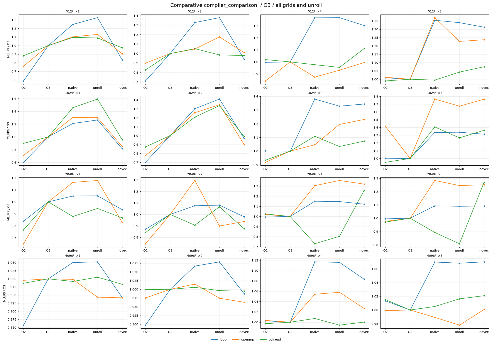{width=95%}

Дополнительные графики для каждой версии доступны в [`loop/figures`](../loop/figures/), [`openmp/figures`](../openmp/figures/) и [`pthread/figures`](../pthread/figures/). Режим `-fno-tree-vectorize` нужен как контрольный опыт: если его производительность ниже, это свидетельствует о вкладе векторизации компилятора; если нет, результат необходимо интерпретировать с учётом структуры ядра и ограничений памяти.

## Причины неполной масштабируемости

При увеличении $P$ производительность ограничивают несколько факторов. Во-первых, параллельные версии не ускоряются пропорционально $P$ из-за **обязательного барьера на каждом временном шаге**; в Pthreads стоимость барьера включает операции POSIX-семафоров. Во-вторых, все потоки обращаются к общей памяти, и несколько массивов больших размеров могут выйти за пределы кэша последнего уровня. В-третьих, возможны эффекты NUMA, миграции нитей и ограничения размещения на физических ядрах. В-четвёртых, граничные строки и инициализация составляют последовательную либо непараллелизуемую часть полного выполнения.

Это **возможные механизмы**, согласующиеся с тенденцией графиков, но не результаты отдельного профилирования аппаратных счётчиков: для количественного разделения причин потребуются измерения пропускной способности памяти, кэш-промахов, NUMA-размещения и времени барьеров.

# Заключение

Реализована явная пятиточечная разностная схема для двумерного уравнения теплопроводности с однородными условиями Неймана на вертикальных границах и Дирихле на горизонтальных. Корректность проверяется методом изготовленного решения; при увеличении пространственного разрешения наблюдается снижение максимальной ошибки. Использование двух буферов устраняет зависимости между вычислениями узлов внутри одного временного слоя.

Разработаны последовательная оптимизированная версия с ручной раскруткой на `1,2,4,8` узлов, реализация OpenMP со статическим распределением строк и версия Pthreads с древовидным семафорным барьером. Проведённое исследование охватывает `6000` измерений. В контролируемом сравнении `-O3`, $q=4$, $P=36$ на сетке $2048^2$ достигнуто **13459,67 MLUPS** (OpenMP) и **10168,17 MLUPS** (Pthreads) против **622,05 MLUPS** последовательной программы; отношение производительностей равно соответственно **21,64** и **16,35**.

При этом выигрыш существенно зависит от сетки и компилятора: $q=4$ не всегда лучше $q=1$, а на сетке $4096^2$ заметно снижается эффективность потоков. Для корректной оценки ускорения важно различать сравнение с фиксированной последовательной конфигурацией и сравнение с *лучшей* найденной последовательной реализацией. Также необходимо учитывать удвоенное число шагов у OpenMP и отсутствие некоторых параметров физической задачи в архивных CSV.

Таким образом, при исследованных условиях OpenMP демонстрирует наиболее высокую пропускную способность в приведённом контролируемом сравнении, но универсальный выбор коэффициента раскрутки и числа нитей без измерений невозможен.

# Приложение: воспроизводимость и исходные данные

## Сборка

Примеры команд для GNU C++ (на CPU без AVX-512 не следует использовать `-march=skylake-avx512`):

```bash
g++ -std=c++17 -O3 sequence.cpp -o sequence
g++ -std=c++17 -O3 loop/sequence.loop.cpp -o heat_loop
g++ -std=c++17 -O3 -fopenmp openmp/openmp.loop.cpp -o heat_omp
g++ -std=gnu++17 -O3 -pthread pthread/pthread.loop.cpp -o heat_pthread
```

Версия Pthreads использует массивы локальной длины `pthread_t threads[num_threads]` и `thread_args_t args[num_threads]` — расширение GNU C++, не являющееся стандартной конструкцией ISO C++17.

**Для запуска бенчмарков обязательно задавать согласованные `--t0`, `--t1`, `--a`, размеры сетки и число шагов**; нельзя просто запускать большие сетки со встроенными $a=1$, $t_1=10$, $N=700$ из оптимизированных исходников, поскольку тогда нарушается условие (16).

## Где искать полные данные

Таблицы `results.csv` содержат индивидуальные времена пяти повторений; `summary.csv` — агрегаты. В `metadata.json` сохранены наборы параметров, профили компиляции и номера заданий. [`comparison_summary.csv`](../comparison_summary.csv) задаёт конкретные срезы для сопоставления трёх версий. Исходные коды и полный набор иллюстраций остаются в проекте и не дублируются в отчёте целиком.

## Экспорт Markdown в PDF

На Ubuntu установить Pandoc, XeLaTeX и кириллические шрифты:

```bash
sudo apt update
sudo apt install pandoc texlive-xetex texlive-lang-cyrillic fonts-dejavu-core
```

**Команда экспорта** (запускать из корня репозитория; изображения берутся непосредственно из существующих каталогов `figures/`):

```bash
cd report
pandoc report.md -o report.pdf \
  --from markdown+tex_math_dollars \
  --pdf-engine=xelatex \
  --resource-path=".:.." \
  --toc --number-sections \
  -V mainfont="DejaVu Serif" \
  -V monofont="DejaVu Sans Mono" \
  -V lang=ru-RU \
  -V geometry:margin=2.4cm \
  -V fontsize=11pt
```
