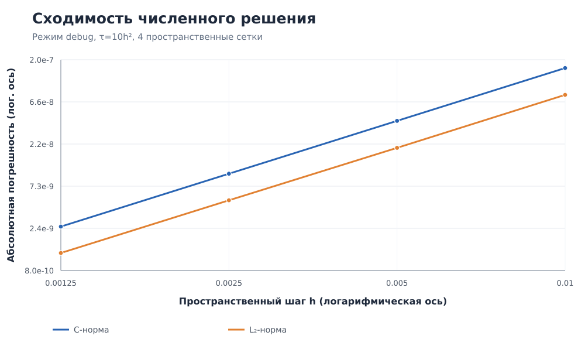
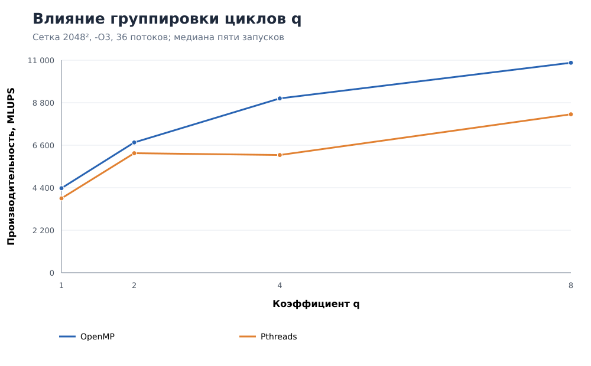
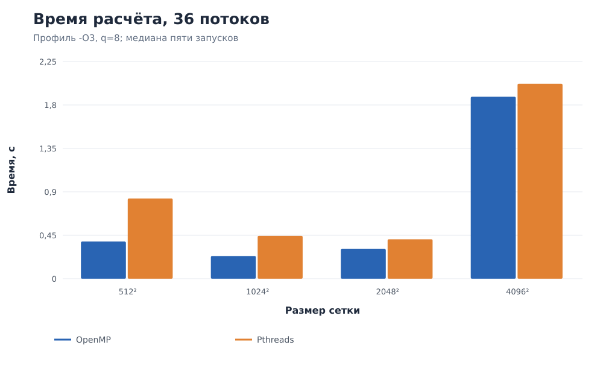
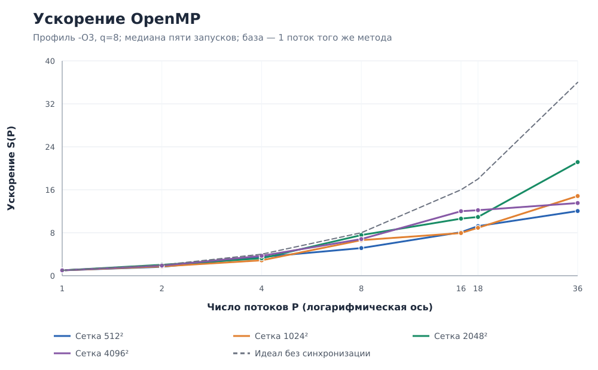
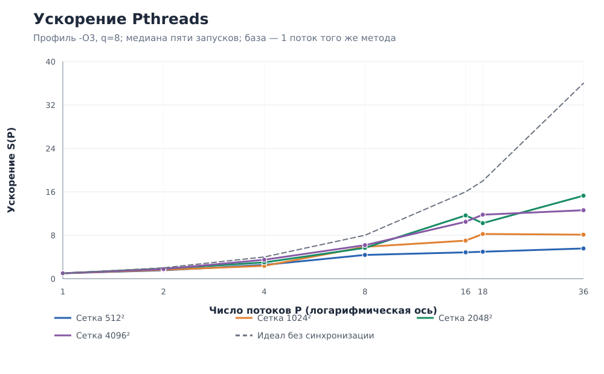
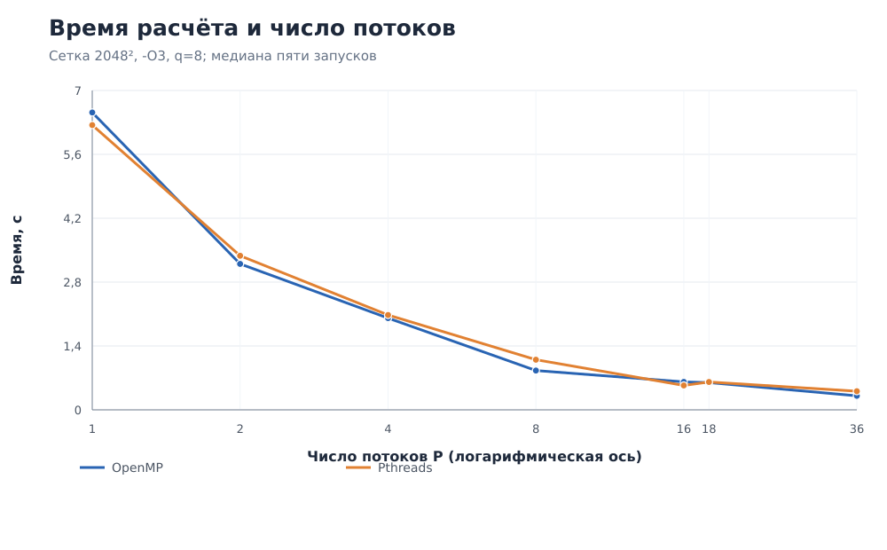
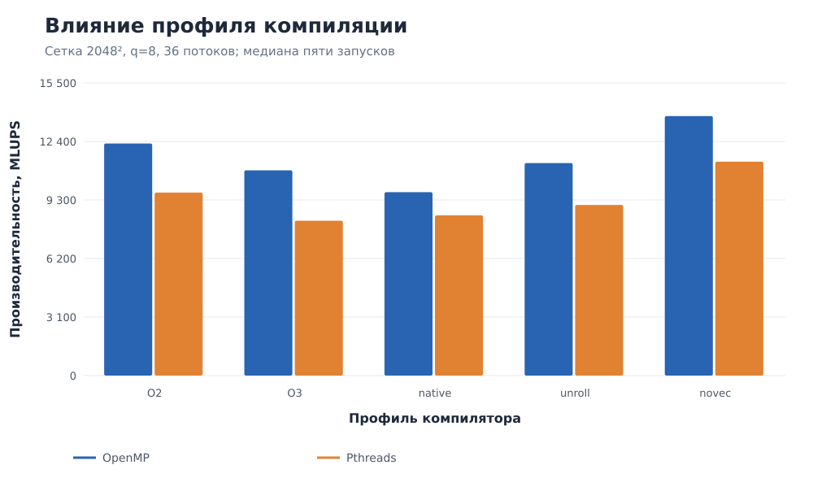

<div class="report-cover" align="center">
<p><strong>МОСКОВСКИЙ ГОСУДАРСТВЕННЫЙ УНИВЕРСИТЕТ<br>
ИМЕНИ М. В. ЛОМОНОСОВА</strong></p>
<p><strong>ФИЛИАЛ МОСКОВСКОГО ГОСУДАРСТВЕННОГО УНИВЕРСИТЕТА<br>
ИМЕНИ М. В. ЛОМОНОСОВА В ГОРОДЕ САРОВЕ</strong></p>
<p></p>
<p>&nbsp;</p><p>&nbsp;</p><p>&nbsp;</p>
<p><strong>Отчёт:</strong></p>
<p>«Численное решение двумерного уравнения теплопроводности:<br>
последовательная оптимизация, OpenMP и Pthreads»</p>
<p>&nbsp;</p><p>&nbsp;</p>
<p align="right">Выполнил студент<br>
2-го курса магистратуры<br>
Василенко Д.О.<br>
Группа: СКТ-225</p>
<p>&nbsp;</p><p>&nbsp;</p>
<p>Саров 2026</p>
</div>

# Постановка задачи

## Математическая модель

Рассматривается начально-краевая задача для двумерного нестационарного уравнения теплопроводности в прямоугольной области

$$
\Omega = \{(x,y)\mid 0\le x\le L_x,\ 0\le y\le L_y\},\qquad t\in[t_0,t_1].
$$

Модель имеет вид

$$
\boxed{
\frac{\partial u}{\partial t}
=a^2\left(\frac{\partial^2u}{\partial x^2}
+\frac{\partial^2u}{\partial y^2}\right)+f(t,x,y)
}
\tag{1}
$$

Здесь $u(t,x,y)$ — искомое поле температуры, $a^2$ — коэффициент диффузии в выбранной записи уравнения, $f$ — функция источника. Обозначение $a$ взято непосредственно из программы; это важно, поскольку в расчётной схеме коэффициент возводится в квадрат.

Для задачи проверки начальное условие выбрано из известной аналитической функции:

$$
u(t_0,x,y)=(1+t_0)
\cos\frac{\pi x}{L_x}\sin\frac{\pi y}{L_y}.
\tag{2}
$$

На вертикальных сторонах области заданы однородные условия **Неймана**:

$$
\left.\frac{\partial u}{\partial x}\right|_{x=0}=0,
\qquad
\left.\frac{\partial u}{\partial x}\right|_{x=L_x}=0.
\tag{3}
$$

На горизонтальных сторонах заданы однородные условия **Дирихле**:

$$
u(t,x,0)=0,\qquad u(t,x,L_y)=0.
\tag{4}
$$

В `relax()` значения крайних строк по $y$ явно не пересчитываются: оба выделенных массива первоначально заполнены нулями, внутренние циклы исключают $j=0$ и $j=N_y-1$, а обмен указателей сохраняет нулевые граничные строки. По $x$ значения границы вычисляются на каждом временном слое с использованием трёх соседних узлов.

# Аналитическое решение

## Функция с заранее известным решением

Для проверки выбрана функция

$$
\boxed{
u_{\mathrm{ex}}(t,x,y)
=(1+t)\cos\frac{\pi x}{L_x}\sin\frac{\pi y}{L_y}
}
\tag{5}
$$

Её реализация в `u_exact()` совпадает с формулой:

```cpp
double u_exact(double t, double x, double y,
               double Lx, double Ly) {
  return (1.0 + t) *
         cos(x * M_PI / Lx) *
         sin(y * M_PI / Ly);
}
```

## Метод подбора функции источника

Дифференцирование (5) даёт

$$
u_t=\cos\frac{\pi x}{L_x}\sin\frac{\pi y}{L_y},
$$

$$
u_{xx}=-(1+t)\frac{\pi^2}{L_x^2}
\cos\frac{\pi x}{L_x}\sin\frac{\pi y}{L_y},
$$

$$
u_{yy}=-(1+t)\frac{\pi^2}{L_y^2}
\cos\frac{\pi x}{L_x}\sin\frac{\pi y}{L_y}.
$$

Из (1) следует

$$
f=u_t-a^2(u_{xx}+u_{yy}),
$$

откуда

$$
\boxed{
f(t,x,y)=
\left[1+a^2(1+t)\pi^2
\left(\frac1{L_x^2}+\frac1{L_y^2}\right)\right]
\cos\frac{\pi x}{L_x}\sin\frac{\pi y}{L_y}
}
\tag{6}
$$

Проверка граничных условий: производная $u_x$ содержит множитель $\sin(\pi x/L_x)$ и обращается в ноль при $x=0,L_x$; сама функция $u$ содержит $\sin(\pi y/L_y)$ и обращается в ноль при $y=0,L_y$. Начальное условие (2) выполняется тождественно.

# Численное решение

## Сетка и аппроксимация производных

Равномерная пространственно-временная сетка определяется как

$$
x_i=ih_x,\quad h_x=\frac{L_x}{N_x-1},\quad i=0,\ldots,N_x-1,
$$

$$
y_j=jh_y,\quad h_y=\frac{L_y}{N_y-1},\quad j=0,\ldots,N_y-1,
$$

$$
t_n=t_0+n\tau,\quad \tau=\frac{t_1-t_0}{N},\quad n=0,\ldots,N.
\tag{8}
$$

Введём $U^n_{i,j}\approx u(t_n,x_i,y_j)$. Для производной по времени используется прямая разность, а для вторых пространственных производных — центральные:

$$
u_t\approx\frac{U^{n+1}_{i,j}-U^n_{i,j}}{\tau},
$$

$$
u_{xx}\approx
\frac{U^n_{i+1,j}-2U^n_{i,j}+U^n_{i-1,j}}{h_x^2},
\qquad
u_{yy}\approx
\frac{U^n_{i,j+1}-2U^n_{i,j}+U^n_{i,j-1}}{h_y^2}.
\tag{9}
$$

Подстановка (9) в (1) даёт явную пятиточечную схему:

$$
\boxed{\begin{aligned}
U^{n+1}_{i,j}={}&U^n_{i,j}
+r_x(U^n_{i+1,j}-2U^n_{i,j}+U^n_{i-1,j})\\
&+r_y(U^n_{i,j+1}-2U^n_{i,j}+U^n_{i,j-1})
+\tau f(t_n,x_i,y_j),
\end{aligned}}
\tag{10}
$$

где

$$
r_x=\frac{a^2\tau}{h_x^2},\qquad
r_y=\frac{a^2\tau}{h_y^2}.
\tag{11}
$$

При достаточной гладкости решения локальная погрешность аппроксимации соответствует первому порядку по времени и второму по пространству: $O(\tau+h_x^2+h_y^2)$.

## Схема в исходном коде

Двумерный массив хранится линейно, в порядке строк:

$$
k=jN_x+i,\qquad U^n_{i,j}\longleftrightarrow U[k].
\tag{12}
$$

Это даёт последовательный доступ по `i` во внутреннем цикле, что важно для кэша и векторизации. Вычислительное ядро в [`sequence.cpp`](../sequence.cpp) имеет вид:

```cpp
for (int j = 1; j < Ny - 1; j++) {
  for (int i = 1; i < Nx - 1; i++) {
    int k = j * Nx + i;
    U_next[k] =
        U[k]
      + rx * (U[k + 1] - 2 * U[k] + U[k - 1])
      + ry * (U[k + Nx] - 2 * U[k] + U[k - Nx])
      + tau * f(tn, i * hx, j * hy, a, Lx, Ly);
  }
}
```

## Граничные условия и обмен буферов

На $x=0$ аппроксимация нулевой производной односторонней разностью второго порядка:

$$
\frac{-3U^{n+1}_{0,j}+4U^{n+1}_{1,j}-U^{n+1}_{2,j}}{2h_x}=0.
$$

Следовательно,

$$
U^{n+1}_{0,j}=\frac{4U^{n+1}_{1,j}-U^{n+1}_{2,j}}3.
\tag{13}
$$

Аналогично на правой границе:

$$
U^{n+1}_{N_x-1,j}=
\frac{4U^{n+1}_{N_x-2,j}-U^{n+1}_{N_x-3,j}}3.
\tag{14}
$$

Именно формулы (13)–(14) реализованы в граничном цикле `relax()`. Для каждого временного слоя используются два массива `U` и `U_next`: все узлы нового слоя вычисляются из _неизменяемого_ старого, после чего выполняется `swap(U, U_next)`. Это устраняет зависимости запись–чтение между внутренними узлами одного слоя и делает возможным распараллеливание по строкам.

## Условие устойчивости и допустимые параметры

Для стандартной явной схемы теплопроводности необходимо

$$
\boxed{r_x+r_y\le\frac12.}
\tag{15}
$$

Подставляя (8) и (11), получим

$$
\boxed{
N\ge N_{\min}=
2a^2(t_1-t_0)\left(\frac1{h_x^2}+\frac1{h_y^2}\right).
}
\tag{16}
$$

Проверка (16) выполняется программой в `validate()` до выделения массивов и основного вычисления.

# Верификация

## Контроль результата

В режиме `--debug 1` включается источник (6), а после `relax()` вызывается `verify()`. В конечный момент $t_1$ вычисляется разность

$$
e_{i,j}=U^N_{i,j}-u_{\mathrm{ex}}(t_1,x_i,y_j).
\tag{17}
$$

Программа выводит две нормы:

$$
\|e\|_C=\max_{i,j}|e_{i,j}|,
\tag{18}
$$

$$
\|e\|_{L_2,h}=
\sqrt{h_xh_y\sum_{j=0}^{N_y-1}\sum_{i=0}^{N_x-1}e_{i,j}^2}
\approx \left(\int_{\Omega}|e(x,y)|^2\,dx\,dy\right)^{1/2}.
\tag{19}
$$

Ключевой фрагмент функции [`verify()`](../sequence.cpp):

```cpp
double error_inf = 0.0;
double error_l2 = 0.0;
for (int j = 0; j < Ny; ++j) {
  for (int i = 0; i < Nx; ++i) {
    double exact = u_exact(t1, i * hx, j * hy, Lx, Ly);
    double error = abs(U[j * Nx + i] - exact);
    error_inf = max(error_inf, error);
    error_l2 += error * error;
  }
}
error_l2 = sqrt(hx * hy * error_l2);
```

## Проверка сходимости на сгущающихся сетках

Для аналитического решения используется режим `--debug 1`, в котором функция источника \(f\) не равна нулю. Параметры верификации: \(L_x=L_y=1\), \(a=0{,}1\), \(t_0=0\), \(t_1=0{,}01\). Исследуются четыре пространственных шага \(h=h_x=h_y\) и четыре временных шага \(\tau\):

| \(h\) | \(N_x=N_y\) | \(\tau\) (диагональная серия) | Число шагов \(N\) |
|---:|---:|---:|---:|
| 0,01 | 101 | 0,001 | 10 |
| 0,005 | 201 | 0,00025 | 40 |
| 0,0025 | 401 | 0,0000625 | 160 |
| 0,00125 | 801 | 0,000015625 | 640 |

Условие устойчивости для квадратной сетки имеет вид:

$$
\tau\leq\frac{h^2}{4a^2}.
$$

Из 16 сочетаний десять удовлетворяют условию устойчивости. В остальных шести ячейках таблиц стоит прочерк. Погрешности вычислены относительно функции \(u_{\mathrm{exact}}\) по нормам \(C\) и сеточной \(L_2\). Все 10 допустимых расчётов можно повторить одной командой `python3 scripts/run_errors.py`.

**Таблица абсолютной погрешности в C-норме**

| h / τ | 0.001 | 0.00025 | 6.25e-05 | 1.5625e-05 |
|---:|---:|---:|---:|---:|
| 0.01 | 1.60811e-07 | 1.60679e-07 | 1.60634e-07 | 1.60622e-07 |
| 0.005 | — | 4.03414e-08 | 4.03257e-08 | 4.03216e-08 |
| 0.0025 | — | — | 1.01019e-08 | 1.01013e-08 |
| 0.00125 | — | — | — | 2.52864e-09 |

**Таблица абсолютной погрешности в L₂-норме**

| h / τ | 0.001 | 0.00025 | 6.25e-05 | 1.5625e-05 |
|---:|---:|---:|---:|---:|
| 0.01 | 7.97084e-08 | 7.96969e-08 | 7.96954e-08 | 7.96951e-08 |
| 0.005 | — | 1.98742e-08 | 1.98675e-08 | 1.98658e-08 |
| 0.0025 | — | — | 5.02855e-09 | 5.02832e-09 |
| 0.00125 | — | — | — | 1.26534e-09 |

Результаты всех сочетаний приведены также в файле [errors/errors_grid_full.csv](../errors/errors_grid_full.csv). Отдельные таблицы для прямого построения графиков: [errors_matrix_c.csv](../errors/errors_matrix_c.csv) и [errors_matrix_l2.csv](../errors/errors_matrix_l2.csv).

По диагональной серии с \(\tau=10h^2\) наблюдаемый порядок вычисляется как

$$
p=\log_2\frac{E(h)}{E(h/2)}.
$$

Средний наблюдаемый порядок составляет \(p_C\approx1{,}997\), \(p_{L_2}\approx1{,}992\). Это согласуется с ожидаемой погрешностью \(O(\tau+h^2)\). При фиксированном \(h\) дальнейшее уменьшение \(\tau\) даёт небольшой выигрыш: начинает преобладать пространственная составляющая ошибки.

{width=92%}

Контрольная сумма \( \sum_k U[k]^2 \) применяется отдельно для проверки согласованности реализаций; она не заменяет норм погрешности.

# Программная реализация

## Организация исходных файлов

В проекте реализованы:

| Файл                                                      | Роль                                                          |
| :-------------------------------------------------------- | :------------------------------------------------------------ |
| [`sequence.cpp`](../sequence.cpp)                         | Начальная последовательная схема и интерфейс командной строки |
| [`loop/sequence.loop.cpp`](../loop/sequence.loop.cpp)     | Последовательная версия с ручной раскруткой циклов            |
| [`openmp/openmp.loop.cpp`](../openmp/openmp.loop.cpp)     | Многопоточная OpenMP-версия                                   |
| [`pthread/pthread.loop.cpp`](../pthread/pthread.loop.cpp) | Многопоточная реализация на POSIX Threads                     |

Общий программный маршрут: чтение параметров → `parse()` → `validate()` → выделение двух буферов → `relax()` → при необходимости `verify()` → освобождение памяти.

## Параметры

Исходный вариант задаётся структурой `Config` в [`sequence.cpp`](../sequence.cpp). Во всех версиях массивы температур и основные вещественные вычисления используют тип `double`.

| Параметр    | Ключ      | По умолчанию | Описание                               |
| :---------- | :-------- | ------------: | :------------------------------------- |
| $t_0$       | `--t0`    |                         0 | Начальный момент времени               |
| $t_1$       | `--t1`    |                        10 | Конечный момент времени                |
| $L_x$       | `--Lx`    |                       2,0 | Протяжённость области по $x$           |
| $L_y$       | `--Ly`    |                       1,0 | Протяжённость области по $y$           |
| $N_x$       | `--Nx`    |                       100 | Число сеточных узлов по $x$            |
| $N_y$       | `--Ny`    |                        50 | Число сеточных узлов по $y$            |
| $N$         | `--N`     |                      1000 | Число временных шагов                  |
| $a$         | `--a`     |                       0,1 | Параметр при операторе Лапласа ($a^2$) |
| —           | `--debug` |                         0 | Выбор режима верификации               |

Фрагмент объявления параметров:

```cpp
struct Config {
  double t0 = 0, t1 = 10;
  double Lx = 2.0, Ly = 1.0;
  int Nx = 100, Ny = 50, N = 1000;
  double a = 0.1;
  bool debug = false;
};
```

## Справка `help()` и параметры

Функция `help()` печатает допустимые аргументы. Без аргументов или при первом аргументе `-h`/`--help` программа выводит справку и завершается; `--help` в середине списка `parse()` как самостоятельный флаг не обрабатывает.

| Аргумент       | Варианты                   | Назначение                                              |
| :------------- | :------------------------- | :------------------------------------------------------ |
| `--t0`, `--t1` | Вещественные               | Границы временного интервала                            |
| `--Lx`, `--Ly` | Положительные вещественные | Размеры области                                         |
| `--Nx`, `--Ny` | Целые                      | Размер пространственной сетки                           |
| `--N`          | Целое                      | Число временных шагов                                   |
| `--a`          | Положительное вещественное | Параметр $a$                                            |
| `--debug`      | `0` или `1`                | Выбор режима                                            |
| `--loop`       | `1,2,4,8`                  | Коэффициент ручной раскрутки (оптимизированные версии)  |
| `--threads`    | Положительное целое        | Число нитей (Pthreads; OpenMP задаётся через окружение) |

Не все ключи поддерживаются каждой версией: `--loop` отсутствует в исходной `sequence.cpp`, `--threads` является аргументом Pthreads-версии.

Пример проверки точности:

```bash
./sequence --debug 1 --Nx 100 --Ny 50 --N 1000 \
  --t0 0 --t1 10 --Lx 2 --Ly 1 --a 0.1
```

## Разбор аргументов `parse()`

Функция `parse(int argc, char* argv[], Config& cfg)` последовательно считывает пары «ключ — значение», преобразуя вещественные параметры посредством `std::stod()`, а целочисленные — `std::stoi()`.

```cpp
if (arg == "--t0")
  cfg.t0 = stod(value);
else if (arg == "--N")
  cfg.N = stoi(value);
else if (arg == "--debug")
  cfg.debug = (value == "1");
else
  throw invalid_argument("Неизвестный аргумент: " + arg);
```

## Проверка допустимости `validate()`

Функция `validate()` отвергает невалидный интервал времени, неположительные геометрические параметры и $a$, $N\le0$, $N_x<4$, $N_y<3$. Замер времени включает все $N$ переходов по временным слоям, начиная с перехода от начального слоя $U^0$ к слою $U^1$; первый шаг из замера не исключается. После базовых проверок вычисляется $N_{\min}$ из (16); при нарушении условия устойчивости программа сообщает размеры сетки, $N$ и $N_{\min}$ и завершается.

```cpp
double hx = Lx / (Nx - 1);
double hy = Ly / (Ny - 1);
double N_min = 2 * a * a * (t1 - t0) *
               (1 / (hx * hx) + 1 / (hy * hy));
if (N < N_min) {
  cout << "Условие устойчивости нарушено\n";
  exit(EXIT_FAILURE);
}
```

## Режим отладки

В режиме `debug` выполняются дополнительные вычисления функции $f$ в каждом внутреннем узле и сравнение численного результата с формулой (5). Поэтому время такого запуска нельзя непосредственно сопоставлять с режимом производительности. Основная цель — математическая корректность, включая влияние шага сетки и граничных условий.

## Режим производительности и MLUPS

В производительном режиме $f=0$. Замер охватывает **все $N$ временных шагов** после завершения инициализации массивов. Метрика **MLUPS** (`Million Lattice Updates Per Second`) — миллионы обновлений внутренних узлов в секунду:

$$
\boxed{
\mathrm{MLUPS}=
\frac{N(N_x-2)(N_y-2)}
{10^6\,T_{\mathrm{measure}}}
}.
\tag{20}
$$

Для прямого сопоставления разных чисел шагов удобно использовать нормированное время одного обновления:

$$
t_{\mathrm{update}}[\mathrm{ns}]
=\frac{1000}{\mathrm{MLUPS}}.
\tag{21}
$$

# Оптимизация последовательного алгоритма

## Исходный цикл и локальность памяти

Основная вычислительная работа состоит в применении пятиточечного шаблона ко всем внутренним узлам на каждом временном слое. Выбранный порядок `j` — внешний, `i` — внутренний обеспечивает последовательный доступ к памяти в направлении $x$.

## Группировка итераций внутреннего цикла

Поддерживаются коэффициенты $q\in\{1,2,4,8\}$ через `--loop q`. Узлы группируются по $q$; оставшиеся элементы обрабатываются отдельным циклом. Используется обычная функция с параметром `block`, без шаблонов и перечисления вызовов:

```cpp
int i = 1;
for (; i + block <= Nx - 1; i += block) {
  for (int k = 0; k < block; ++k) {
    // Применение разностной схемы к узлу (i + k, j).
  }
}
for (; i < Nx - 1; ++i) {
  // Применение той же схемы к оставшимся узлам.
}
```

Такая группировка **не означает автоматического разворачивания цикла**: оно зависит от оптимизатора. Влияние параметра `block` проверяется экспериментально; результаты старых запусков к новой реализации напрямую не применимы.

## Влияние оптимизаций компилятора

Испытаны пять профилей:

| Профиль в данных | Флаги компилятора                               |
| :--------------- | :---------------------------------------------- |
| `O2`             | `-O2`                                           |
| `O3`             | `-O3`                                           |
| `native`         | `-O3 -march=skylake-avx512`                     |
| `unroll`         | `-O3 -march=skylake-avx512 -funroll-loops`      |
| `novec`          | `-O3 -march=skylake-avx512 -fno-tree-vectorize` |

Значение параметра `march` можно получить с помощью команды:

```bash
gcc -march=native -Q --help=target | grep march
```

Профили `unroll` и `novec` позволяют отдельно исследовать влияние автоматической раскрутки и векторизации.

Актуальная серия 2026 года показывает, что влияние параметра $q$ зависит от реализации, размера сетки и числа потоков. Для профиля `-O3` и сетки $2048^2$ приведены новые медианные значения при 36 потоках:

{width=92%}

Сравнение с результатами предыдущей серии без согласования числа временных шагов некорректно; прежние рисунки сохранены только в архивных каталогах.

# Параллельные реализации

## Независимость вычислений и принцип разбиения

Из (10) видно, что $U^{n+1}_{i,j}$ зависит только от $U^n$, а не от соседних значений $U^{n+1}$. Следовательно, внутренние узлы _одного_ временного слоя можно вычислять одновременно. При этом между соседними временными шагами необходим барьер: все потоки должны закончить запись нового слоя до обмена буферов и начала следующего шага.

В обеих реализациях распределяются **строки** $j=1,\ldots,N_y-2$. Обновление внутренних узлов и соответствующих вертикальных границ выполняется тем же потоком, который обрабатывает строку. Общая память содержит два массива `double`; дополнительных обменов данных между потоками не требуется.

## OpenMP

В [`openmp/openmp.loop.cpp`](../openmp/openmp.loop.cpp) параллельная область создаётся **один раз** для инициализации и всех временных шагов. Оба массива инициализируются распределённым циклом `schedule(static)` (**first touch**), а последующие расчёты используют статическое распределение строк. При привязке нитей это способствует локальному размещению страниц памяти в NUMA-системе:

```cpp
#pragma omp parallel
{
#pragma omp for schedule(static)
  for (int j = 0; j < Ny; ++j) {
    // Инициализация U и U_next для всей строки j.
  }

  for (int n = 0; n < N; ++n) {
#pragma omp for schedule(static)
    for (int j = 1; j < Ny - 1; ++j) {
      // Расчёт внутренних узлов и границ строки j.
    }
#pragma omp single
    { swap(U, U_next); }
  }
}
```

Число потоков задаётся средой OpenMP, например:

```bash
OMP_NUM_THREADS=8 ./heat_omp --Nx 100 --Ny 50 --N 1000 --a 0.1 --Lx 2 --Ly 1 --loop 4 --debug 0
```

## Pthreads

В [`pthread/pthread.loop.cpp`](../pthread/pthread.loop.cpp) потоки создаются явными вызовами `pthread_create()`. Каждый поток получает диапазон внутренних строк:

$$
j_{\mathrm{start}}(p)=1+\left\lfloor
\frac{(N_y-2)p}{P}
\right\rfloor,\qquad
j_{\mathrm{stop}}(p)=1+\left\lfloor
\frac{(N_y-2)(p+1)}P
\right\rfloor.
\tag{22}
$$

Это разбиение покрывает все внутренние строки без пересечений. Перед вычислениями каждая рабочая нить инициализирует соответствующие строки обоих массивов; крайние строки дополнительно инициализируют первая и последняя нити. Затем выполняется общий барьер. Буферы выделяются без предварительного обнуления. Такой порядок реализует **first touch**; для гарантированной локальности на NUMA-узле привязку нитей задают средствами запуска и системы очередей, а не отдельной функцией в программе:

```cpp
args[i].j_start = 1 + (Ny - 2) * i / num_threads;
args[i].j_stop =
    1 + (Ny - 2) * (i + 1) / num_threads;
args[i].data = &data;
pthread_create(&threads[i], NULL, worker, &args[i]);
```

Внутри `worker()` инициализация выполняется в цикле по закреплённым за нитью строкам до первого шага по времени. В POSIX-системах можно применить `mmap()`, но для first touch он не требуется: достаточно `new double[size]` без `{}` и последующей параллельной записи.

Для синхронизации реализован собственный **древовидный барьер на POSIX-семафорах** (`sem_wait/sem_post`): каждый поток ожидает завершения дочерних потоков в бинарном дереве, затем сигнализирует родителю; поток с номером 0 после сбора всех сигналов меняет местами указатели и распространяет разрешение на следующий временной шаг обратно вниз по дереву. Такая схема выполняет сбор и рассылку по дереву глубины $O(\log P)$, хотя фактическое время зависит от накладных расходов системных семафоров.

Ключевой фрагмент `barrier()`:

```cpp
int left = 2 * thread_num + 1;
int right = 2 * thread_num + 2;

if (left < num_threads)
  sem_wait(&b->sem[thread_num]);
if (right < num_threads)
  sem_wait(&b->sem[thread_num]);

if (thread_num == 0)
  swap(data->U, data->U_next);
else {
  int parent = (thread_num - 1) / 2;
  sem_post(&b->sem[parent]);
  sem_wait(&b->sem[thread_num]);
}

if (left < num_threads) sem_post(&b->sem[left]);
if (right < num_threads) sem_post(&b->sem[right]);
```

После выполнения рабочих циклов вызываются `pthread_join()` и освобождение семафоров. Число потоков задаётся аргументом `--threads`:

# Аналитическая оценка времени решения

## Теоретическая вычислительная модель при f=0

Начальному состоянию соответствует слой \(U^0\), а первый вычисленный слой \(U^1\) является вторым временным слоем. Следовательно, получение слоёв \(U^1,\ldots,U^N\) требует ровно \(N\) шагов. Измеряемый в программе участок также содержит все \(N\) шагов и **не включает первоначальное заполнение массивов**.

В режиме оценки производительности внешние силы отсутствуют (\(f=0\)). Для одного внутреннего узла реализована пятиточечная схема:

$$
U^{n+1}_{i,j}=U^n_{i,j}
+r_x\bigl(U^n_{i+1,j}-2U^n_{i,j}+U^n_{i-1,j}\bigr)
+r_y\bigl(U^n_{i,j+1}-2U^n_{i,j}+U^n_{i,j-1}\bigr).
\tag{25}
$$

При прямом подсчёте операций выражение требует **4 умножения и 6 сложений/вычитаний**, то есть 10 арифметических операций на внутренний узел. В каждой внутренней строке дополнительно рассчитываются два узла на границах Неймана: на каждую граничную формулу приходятся умножение, вычитание и деление — всего 6 операций на строку.

Обозначим \(R=N_y-2\) (число рабочих строк), \(C=10(N_x-2)+6\) (число арифметических операций на одну строку), \(P\) (число нитей). Пусть \(\tau_c\) — условное время **одной арифметической операции**, а не одной ячейки, \(\tau_s^{\mathrm{OMP}}\) — время одного полного барьера OpenMP, \(\tau_s^{\mathrm{pth}}\) — характерное время передачи сигнала по одному уровню двоичного дерева барьера Pthreads.

Для последовательной версии:

$$
\boxed{T_{\mathrm{seq}}(N_x,N_y,N)=NRC\tau_c.}
\tag{26}
$$

Для OpenMP с распределением строк `schedule(static)` и двумя обязательными синхронизациями на шаг (после `omp for` и после `omp single`):

$$
\boxed{T_{\mathrm{OMP}}(P)\approx N\left[
\left\lceil\frac{R}{P}\right\rceil C\tau_c+
2\tau_s^{\mathrm{OMP}}
\right].}
\tag{27}
$$

Для реализованного двоичного дерева семафоров Pthreads требуется этап сбора сигналов и этап рассылки; грубая верхняя оценка глубины дерева даёт:

$$
\boxed{T_{\mathrm{pth}}(P)\approx N\left[
\left\lceil\frac{R}{P}\right\rceil C\tau_c+
2\left\lceil\log_2P\right\rceil\tau_s^{\mathrm{pth}}
\right],\quad P>1.}
\tag{28}
$$

При \(P=1\) межнитевую синхронизацию принимаем нулевой. Модели (26)–(28) являются **аналитическими оценками арифметической трудоёмкости и синхронизаций**, а не точными предсказателями секунд: они не учитывают иерархию памяти, векторизацию, FMA, динамику частот, планирование и стоимость управления циклами. Величины \(\tau_s^{\mathrm{OMP}}\) и \(\tau_s^{\mathrm{pth}}\) определены по-разному, поэтому их численные значения нельзя автоматически приравнивать.

## Таблица аналитического времени

В таблице указаны коэффициенты при \(\tau_c\) и при временах синхронизации. Для OpenMP и Pthreads представлена конфигурация \(P=36\).

| Сетка | \(N\) | \(T_{\mathrm{seq}}/\tau_c\) | \(A_{36}=N\lceil R/36\rceil C\) | OpenMP: число барьеров | Pthreads: уровни синхронизации |
|---:|---:|---:|---:|---:|---:|
| \(512^2\) | 10000 | 26 040 600 000 | 765 900 000 | 20 000 | 120 000 |
| \(1024^2\) | 2000 | 20 901 944 000 | 593 108 000 | 4 000 | 24 000 |
| \(2048^2\) | 800 | 33 498 748 800 | 933 249 600 | 1 600 | 9 600 |
| \(4096^2\) | 800 | 134 106 339 200 | 3 734 275 200 | 1 600 | 9 600 |

Например, для сетки \(512^2\):

$$
\begin{aligned}
T_{\mathrm{seq}}&=26\,040\,600\,000\,\tau_c,\\
T_{\mathrm{OMP}}(36)&\approx765\,900\,000\,\tau_c+20\,000\,\tau_s^{\mathrm{OMP}},\\
T_{\mathrm{pth}}(36)&\approx765\,900\,000\,\tau_c+120\,000\,\tau_s^{\mathrm{pth}}.
\end{aligned}
\tag{29}
$$

Для получения абсолютного теоретического времени в секундах потребовались бы отдельные измерения \(\tau_c\) и обеих констант синхронизации на исследуемой вычислительной системе. В настоящем отчёте **они не заменяются** эмпирическим временем одного обновления или значениями MLUPS: это были бы иные физические величины. На графиках ускорения показана отдельная линия идеального линейного ускорения \(S_{\mathrm{ideal}}(P)=P\) без затрат на синхронизацию; она служит теоретическим ориентиром, а не калиброванной моделью реального времени.

# Исследование производительности

## Экспериментальная база и методика

Для сопоставимых расчётов использованы четыре квадратные сетки: \(512^2\) (\(N=10000\)), \(1024^2\) (\(N=2000\)), \(2048^2\) и \(4096^2\) (обе \(N=800\)). Во всех версиях установлены \(t_0=0\), \(t_1=0{,}001\), \(a=0{,}1\), \(L_x=L_y=1\), \(f=0\). Использован GCC 7.4; проверены пять профилей `O2`, `O3`, `native`, `unroll`, `novec`, развёртка \(q\in\{1,2,4,8\}\), числа нитей \(P\in\{1,2,4,8,16,18,36\}\).

Для каждой конфигурации получено **пять повторений**; всего 6000 измерений и 1200 уникальных конфигураций. Все результаты основной серии имеют положительное время и MLUPS, без пропусков и повторных ключей. Контрольная сумма остаётся постоянной в пределах точности вывода при фиксированном размере сетки. Она не заменяет проверку численной точности в режиме `debug`.

Для дальнейшего анализа используется **медиана пяти времен**, а не отдельное наиболее удачное измерение. Величина MLUPS рассчитывается по формуле (20). Компактный набор опорных медиан новых графиков помещён в [results/2026/selected_medians.csv](../results/2026/selected_medians.csv). Полный архив из 6000 измерений должен храниться отдельно без смешивания с пробными заданиями.

## Сравнение времени OpenMP и Pthreads

При профиле `-O3`, \(q=8\) и 36 нитях получены следующие медианы:

| Сетка | Последовательная, с | OpenMP, с | Pthreads, с | Pthreads / OpenMP |
|---:|---:|---:|---:|---:|
| \(512^2\) | 4,6461 | 0,3852 | 0,8304 | 2,16 |
| \(1024^2\) | 3,5710 | 0,2353 | 0,4442 | 1,89 |
| \(2048^2\) | 6,5718 | 0,3081 | 0,4083 | 1,33 |
| \(4096^2\) | 25,8914 | 1,8851 | 2,0200 | 1,07 |

{width=95%}

На сетке \(512^2\) OpenMP быстрее Pthreads примерно в 2,16 раза. На сетке \(4096^2\) преимущество сокращается до 1,07 раза. Из имеющихся замеров нельзя однозначно приписать эту зависимость только работе NUMA или пропускной способности памяти — необходима отдельная аппаратная диагностика.

## Ускорение и эффективность

Для каждой параллельной реализации \(m\) ускорение определяется относительно **её собственной** однопоточной версии при одинаковых сетке, профиле компиляции и \(q\):

$$
S_m(P)=\frac{\operatorname{median}T_m(1)}{\operatorname{median}T_m(P)},
\qquad E_m(P)=\frac{S_m(P)}{P}\cdot100\%.
\tag{30}
$$

| Сетка | \(S_{\mathrm{OMP}}(36)\) | \(E_{\mathrm{OMP}}(36)\) | \(S_{\mathrm{pth}}(36)\) | \(E_{\mathrm{pth}}(36)\) |
|---:|---:|---:|---:|---:|
| \(512^2\) | 12,05 | 33,47% | 5,57 | 15,47% |
| \(1024^2\) | 14,84 | 41,21% | 8,12 | 22,55% |
| \(2048^2\) | 21,15 | 58,76% | 15,29 | 42,46% |
| \(4096^2\) | 13,54 | 37,61% | 12,61 | 35,02% |

{width=94%}

{width=94%}

{width=94%}

Идеальная линия \(S=P\) показана для ориентира. График разности или относительного отклонения теоретического и экспериментального времени **не строится**.

## Влияние группировки циклов

Для сетки \(2048^2\), профиля `-O3` и 36 потоков увеличение \(q\) улучшает производительность обеих параллельных версий. При этом зависимость не обязана быть монотонной для всех размеров сеток и профилей — группировка в исходном коде не равнозначна гарантированной автоматической развёртке.

{width=94%}

## Влияние параметров компилятора

При одинаковых сетке \(2048^2\), \(q=8\) и \(P=36\) измерена следующая производительность:

| Профиль | OpenMP, MLUPS | Pthreads, MLUPS |
|---|---:|---:|
| O2 | 12 290,9 | 9 691,0 |
| O3 | 10 870,1 | 8 201,7 |
| native | 9 714,7 | 8 487,4 |
| unroll | 11 254,1 | 9 038,8 |
| novec | 13 744,4 | 11 328,1 |

{width=94%}

На этой конфигурации профиль `novec` показывает более высокую медианную производительность OpenMP, чем `O3`, однако в некоторых конфигурациях наблюдается значительный разброс между повторами. Нельзя делать общий вывод о вреде векторизации только по одному набору измерений: влияние флагов зависит от размещения данных, компилятора и поведения системы памяти.

## Повторяемость результатов

Медианный коэффициент вариации пяти повторов по 1200 конфигурациям составляет около **6,54%**. У **329** конфигураций он превышает 10%, у **34** — 20%; для отдельных конфигураций превышает 30%. Поэтому единичные значения в максимумe производительности нельзя считать устойчивым результатом. В приведённых таблицах использованы медианы; исходные пять повторений не удалены и не заменены усреднёнными значениями.

# Выводы

1. **Численная корректность.** На четырёх согласованных пространственно-временных сетках наблюдаемый порядок сходимости по \(C\)- и \(L_2\)-нормам близок ко второму. Две таблицы 4×4 показывают зависимость погрешности от обоих шагов и выделяют сочетания, нарушающие условие устойчивости.

2. **Аналитическая оценка.** Для \(f=0\) выведены символические зависимости времени от \(N_x,N_y,N,P,\tau_c,\tau_s\). Они отдельно учитывают стоимость арифметики и структуру синхронизации OpenMP и Pthreads. Без независимого измерения \(\tau_c\) и \(\tau_s\) интерпретировать такую оценку как точный прогноз секунд нельзя.

3. **Параллельная производительность.** По медианам пяти запусков OpenMP превосходит Pthreads во всех четырёх выбранных сравнениях при \(q=8\), 36 потоках и `-O3`; преимущество уменьшается с ростом сетки. Ускорение существенно нелинейно по \(P\).

4. **Оптимизации.** Коэффициент группировки \(q\) и флаги компиляции изменяют результаты совместно. Для части конфигураций `novec` быстрее `O3`, что требует осторожной интерпретации без аппаратной профилировки.

5. **Ограничения измерений.** Существенная вариативность отдельных повторов требует публикации медиан и сохранения исходных CSV. Выводы относятся к протестированной версии кода, параметрам задач и оборудованию кластера.

# Приложение

## Сборка

### Компиляция исходных файлов

Команды сборки с базовым профилем `-O3`:

```bash
g++ -std=c++17 -O3 sequence.cpp -o heat_original
g++ -std=c++17 -O3 loop/sequence.loop.cpp -o heat_loop
g++ -std=c++17 -O3 -fopenmp openmp/openmp.loop.cpp -o heat_omp
g++ -std=c++17 -O3 -pthread pthread/pthread.loop.cpp -o heat_pthread
```

Для OpenMP нужен флаг `-fopenmp`, для Pthreads — `-pthread`. Это соответствует `scripts/build.sh` с настройками по умолчанию.

### Автоматическая сборка с профилями компилятора

```bash
bash scripts/build.sh
OPT_FLAGS="-O2" bash scripts/build.sh
```

Профили `native`, `unroll` и `novec` используют `ARCH=skylake-avx512` по умолчанию, если архитектура процессора это поддерживает.

## Компиляция PDF

Из корня репозитория на Linux после установки `pandoc`, `xelatex`, `rsvg-convert` и шрифтов DejaVu:

```bash
pandoc report/report.md -o report/report.pdf \
  --pdf-engine=xelatex --resource-path=report:. \
  -V mainfont="DejaVu Serif" -V sansfont="DejaVu Sans" \
  -V monofont="DejaVu Sans Mono" -V lang=ru-RU \
  -V geometry:margin=2cm
```

Пакеты для Ubuntu: `sudo apt install pandoc texlive-xetex texlive-lang-cyrillic lmodern librsvg2-bin fonts-dejavu-core`. Векторные графики SVG преобразуются автоматически через `rsvg-convert`.

## Локальные запуски

### Проверка погрешности

```bash
python3 scripts/run_errors.py
```

Скрипт автоматически собирает последовательную версию с `-O3`, выполняет все допустимые сочетания четырёх шагов по пространству и четырёх шагов по времени в режиме `--debug 1`. Результаты сохраняются в `errors/errors_grid_full.csv`, `errors/errors_matrix_c.csv` и `errors/errors_matrix_l2.csv`. Для неустойчивых сочетаний записывается прочерк; другие скрипты для расчёта ошибок не нужны.

### Производительность с повторениями

```bash
PROFILE=O3 REPEATS=5 bash scripts/run_bench.sh bench_O3.csv
```

Скрипт перебирает те же размеры сеток, числа временных шагов, количество нитей и значения $q=1,2,4,8$ во всех реализациях. Для OpenMP задаётся только `OMP_NUM_THREADS`; дополнительные переменные привязки не установлены.

### Сборка и измерение пяти профилей

```bash
ARCH=skylake-avx512 REPEATS=5 bash scripts/run_profiles.sh
```

В локальном режиме каждый профиль записывается в `bench_profiles/O2.csv`, `O3.csv`, `native.csv`, `unroll.csv` и `novec.csv`.

## Запуск на кластере Slurm

**Из-за недоступности заголовка glibc `features.h` на вычислительном узле программы заранее компилируются на узле входа (`manage-01`), где доступна полноценная среда разработки.** Наличие компилятора `g++` само по себе недостаточно: на узле сборки должны быть системные заголовки.

Перед первой отправкой заданий следует проверить доступность GCC и собрать программы для нужных профилей в каталоге репозитория:

```bash
cd ~/heatconduction
g++ --version
test -r /usr/include/features.h
PROFILES=O3 bash scripts/prepare_binaries.sh
```

Для пяти профилей достаточно один раз выполнить:

```bash
PROFILES="O2 O3 native unroll novec" ARCH=skylake-avx512 bash scripts/prepare_binaries.sh
```

Программы сохраняются по профилям в `build_profiles/O2/`, `build_profiles/O3/` и т. д. Вместе с бинарниками сохраняются библиотеки GCC `libstdc++.so.6`, `libgcc_s.so.1` и `libgomp.so.1`: это позволяет не зависеть от устаревшей `/lib64/libstdc++.so.6` на вычислительном узле. Перед запуском Slurm добавляет собственный каталог `lib` в начало `LD_LIBRARY_PATH`. Совместимость с версией glibc и набором инструкций CPU на вычислительном узле необходимо проверять отдельно. На вычислительном узле больше не выполняются `module load` и компиляция.

Для исключения длительного задания пять повторений распределены между **пятью элементами массива заданий Slurm**. Один элемент запускает все конфигурации для своего профиля **один раз**, а номер повтора берёт из `SLURM_ARRAY_TASK_ID`.

Для профиля `O3`:

```bash
sbatch --export=ALL,PROFILES=O3 scripts/run_cluster.sbatch
```

В файле `run_cluster.sbatch` задан параметр `#SBATCH --array=1-5%1`: Slurm ставит в очередь пять заданий и выполняет не более одного задания этого массива одновременно. Для пяти профилей можно направить в очередь пять массивов:

```bash
for profile in O2 O3 native unroll novec; do
  sbatch --export=ALL,PROFILES="$profile" scripts/run_cluster.sbatch
done
```

Таким образом, для одного профиля требуется пять отдельных заданий, каждое из которых содержит **240 измерений** вместо 1200 в одном задании. Для пяти профилей общее количество измерений остаётся **6000** (25 элементов массива). Ограничение `%1` действует **внутри каждого массива**, а не между отдельными массивами разных профилей.

Каждый элемент копирует готовые программы в индивидуальный временный каталог, чтобы не перезаписывать файлы других заданий. Результаты складываются, например, в `bench_profiles/job_12345/O3_rep1.csv` … `O3_rep5.csv`, где `12345` — номер массива Slurm; журналы сохраняются по шаблону `heatcond-%A_%a.log`.

Компиляция выполняется заранее на узле входа с флагами `-std=c++17`, `-fopenmp` для OpenMP и `-pthread` для Pthreads. Сбой загрузки модуля `/usr/bin/modulecmd` и отсутствие glibc-заголовков на вычислительном узле больше не препятствуют выполнению готовых программ. Библиотеки GCC копируются рядом с бинарниками для запуска на узлах с более старой системной библиотекой C++. Проверку связки можно выполнить через `ldd`, но она не заменяет пробный запуск на вычислительном узле. Лимит времени одного элемента массива установлен `#SBATCH --time=1:00:00` (1 час). При необходимости лимит можно переопределить при отправке задания, если выбранная очередь допускает большее время.

Для каждого элемента нужен один вычислительный узел с 36 доступными CPU. Разделение уменьшает вероятность превышения лимита времени задания, но при строгом лимите даже 240 конфигураций могут оказаться слишком долгими; в таком случае можно дополнительно разделить исследование по размеру сетки. Параметры очереди и времени запуска уточняются для выбранного кластера.

## Полные тексты скриптов

### `scripts/build.sh`

```bash
#!/usr/bin/env bash
set -euo pipefail

cxx="${CXX:-g++}"
read -r -a flags <<< "${OPT_FLAGS:--O3}"
"$cxx" -std=c++17 "${flags[@]}" sequence.cpp -o heat_original
"$cxx" -std=c++17 "${flags[@]}" loop/sequence.loop.cpp -o heat_loop
"$cxx" -std=c++17 "${flags[@]}" -fopenmp openmp/openmp.loop.cpp -o heat_omp
"$cxx" -std=c++17 "${flags[@]}" -pthread pthread/pthread.loop.cpp -o heat_pthread
```

### `scripts/run_errors.py`

```python
#!/usr/bin/env python3
"""Измерение погрешностей на сетке 4x4 по (h, tau).

Запуск из корня проекта: python3 scripts/run_errors.py
Скрипт сам компилирует последовательную реализацию и создаёт каталог errors/.
"""

import argparse
import csv
import math
import os
import re
import shlex
import subprocess
import tempfile
from pathlib import Path

ROOT = Path(__file__).resolve().parent.parent
T0, T1 = 0.0, 0.01
A, LX, LY = 0.1, 1.0, 1.0
DEFAULT_GRIDS = (101, 201, 401, 801)
DEFAULT_STEPS = (10, 40, 160, 640)


def fmt(number):
    return format(number, ".9g")


def error_norms(program, nx, steps):
    command = [
        str(program), "--Nx", str(nx), "--Ny", str(nx),
        "--N", str(steps), "--t0", fmt(T0), "--t1", fmt(T1),
        "--a", fmt(A), "--Lx", fmt(LX), "--Ly", fmt(LY), "--debug", "1",
    ]
    result = subprocess.run(command, capture_output=True, text=True, check=True)
    values = []
    for label in ("C-норма", "l2-норма"):
        match = re.search(r"^" + re.escape(label) + r":\s*([+\-\d.eE]+)",
                          result.stdout, re.MULTILINE)
        if not match:
            raise RuntimeError(f"Не удалось найти {label} для Nx={nx}, N={steps}:\n"
                               + result.stdout)
        value = float(match.group(1))
        if not math.isfinite(value) or value < 0:
            raise ValueError(f"Недопустимая {label}: {value}")
        values.append(value)
    return values


def write_csv(path, header, rows):
    with path.open("w", newline="", encoding="utf-8") as file:
        writer = csv.writer(file, lineterminator="\n")
        writer.writerow(header)
        writer.writerows(rows)


def run(program, grids, steps_values, destination):
    header = ["h/tau"] + [fmt((T1 - T0) / n) for n in steps_values]
    c_rows, l2_rows, all_rows = [], [], []
    done = skipped = 0

    for nx in grids:
        h = LX / (nx - 1)
        c_row, l2_row = [fmt(h)], [fmt(h)]
        for steps in steps_values:
            tau = (T1 - T0) / steps
            # Условие устойчивости из validate() C++:
            # N >= 2*a^2*(t1-t0)*(1/hx^2 + 1/hy^2).
            min_steps = 2 * A**2 * (T1 - T0) * (1 / h**2 + 1 / h**2)
            if steps + 1e-9 < min_steps:
                c_row.append("-")
                l2_row.append("-")
                all_rows.append([nx, nx, fmt(h), fmt(tau), steps,
                                 fmt(T1), fmt(A), "-", "-", "unstable", "-"])
                skipped += 1
                continue

            print(f"Расчёт {done + 1}: Nx=Ny={nx}, N={steps}, "
                  f"h={fmt(h)}, tau={fmt(tau)}", flush=True)
            err_c, err_l2 = error_norms(program, nx, steps)
            c_row.append(fmt(err_c))
            l2_row.append(fmt(err_l2))
            all_rows.append([nx, nx, fmt(h), fmt(tau), steps,
                             fmt(T1), fmt(A), fmt(err_c), fmt(err_l2),
                             "ok", "computed"])
            done += 1
        c_rows.append(c_row)
        l2_rows.append(l2_row)

    destination.mkdir(parents=True, exist_ok=True)
    write_csv(destination / "errors_grid_full.csv",
              ["nx", "ny", "h", "tau", "steps", "t1", "a",
               "error_c", "error_l2", "status", "source"], all_rows)
    write_csv(destination / "errors_matrix_c.csv", header, c_rows)
    write_csv(destination / "errors_matrix_l2.csv", header, l2_rows)
    print(f"Готово: {done} расчётов, {skipped} сочетаний исключены "
          "по условию устойчивости.")
    print(f"Результаты: {destination.resolve()}")


def main():
    parser = argparse.ArgumentParser(description=__doc__)
    parser.add_argument("--output-dir", type=Path, default=ROOT / "errors",
                        help="папка результатов (по умолчанию errors/ в проекте)")
    parser.add_argument("--program", type=Path,
                        help="существующая программа; без этого аргумента собирается автоматически")
    parser.add_argument("--grids", type=int, nargs="+", default=DEFAULT_GRIDS,
                        help="размеры квадратных сеток (для тестирования)")
    parser.add_argument("--steps", type=int, nargs="+", default=DEFAULT_STEPS,
                        help="числа временных шагов (для тестирования)")
    args = parser.parse_args()
    if any(n < 4 for n in args.grids) or any(n < 1 for n in args.steps):
        parser.error("Размеры сеток должны быть >=4, а числа шагов >=1")

    if args.program is not None:
        program = args.program.resolve()
        if not program.is_file():
            parser.error(f"Файл программы отсутствует: {program}")
        run(program, args.grids, args.steps, args.output_dir)
        return

    with tempfile.TemporaryDirectory(prefix="heat_errors_") as tmp:
        program = Path(tmp) / "heat_errors"
        compiler = shlex.split(os.environ.get("CXX", "g++"))
        if not compiler:
            parser.error("Переменная CXX пуста")
        command = compiler + ["-std=c++17", "-O3", str(ROOT / "loop/sequence.loop.cpp"),
                              "-o", str(program)]
        print("Компиляция:", shlex.join(command), flush=True)
        subprocess.run(command, cwd=ROOT, check=True)
        run(program, args.grids, args.steps, args.output_dir)


if __name__ == "__main__":
    main()
```

### `scripts/run_bench.sh`

```bash
#!/usr/bin/env bash
set -euo pipefail

output="${1:-bench_$(date +%Y%m%d_%H%M%S).csv}"
repeats="${REPEATS:-5}"
threads="${THREADS:-1 2 4 8 16 18 36}"
profile="${PROFILE:-O3}"
# Номер повтора задаётся Slurm при запуске массива заданий.
repeat_index="${REPEAT_INDEX:-}"
echo "profile,method,nx,ny,steps,t1,a,threads,unroll,repeat,time_s,mlups,checksum" > "$output"

for config in ${CONFIGS:-512:10000 1024:2000 2048:800 4096:800}; do
  read -r nx steps <<< "${config/:/ }"
  for method in loop openmp pthread; do
    for p in $threads; do
      [[ "$method" == "loop" && "$p" != 1 ]] && continue
      for q in 1 2 4 8; do
        for ((rep=1; rep<=repeats; ++rep)); do
          args=(--Nx "$nx" --Ny "$nx" --N "$steps" --t0 0 --t1 0.001 \
                --a 0.1 --Lx 1 --Ly 1 --loop "$q" --debug 0)
          case "$method" in
            loop) result=$(./heat_loop "${args[@]}") ;;
            openmp) result=$(OMP_NUM_THREADS="$p" ./heat_omp "${args[@]}") ;;
            pthread) result=$(./heat_pthread --threads "$p" "${args[@]}") ;;
          esac
          time_s=$(awk '/^Time:/ {print $2}' <<< "$result")
          mlups=$(awk '/^MLUPS:/ {print $2}' <<< "$result")
          checksum=$(awk '/^Checksum:/ {print $2}' <<< "$result")
          [[ -n "$time_s" && -n "$mlups" && -n "$checksum" ]] || exit 1
          echo "$profile,$method,$nx,$nx,$steps,0.001,0.1,$p,$q,${repeat_index:-$rep},$time_s,$mlups,$checksum" >> "$output"
        done
      done
    done
  done
done

echo "Результаты: $output"
```

### `scripts/run_profiles.sh`

```bash
#!/usr/bin/env bash
set -euo pipefail

dir="${RESULT_DIR:-bench_profiles}"
arch="${ARCH:-skylake-avx512}"
mkdir -p "$dir"

for profile in ${PROFILES:-O2 O3 native unroll novec}; do
  case "$profile" in
    O2) flags="-O2" ;;
    O3) flags="-O3" ;;
    native) flags="-O3 -march=$arch" ;;
    unroll) flags="-O3 -march=$arch -funroll-loops" ;;
    novec) flags="-O3 -march=$arch -fno-tree-vectorize" ;;
    *) echo "Неизвестный профиль: $profile" >&2; exit 1 ;;
  esac

  echo "Профиль $profile: $flags"
  OPT_FLAGS="$flags" bash scripts/build.sh
  PROFILE="$profile" bash scripts/run_bench.sh "$dir/${profile}${REPEAT_INDEX:+_rep${REPEAT_INDEX}}.csv"
done
```

### `scripts/prepare_binaries.sh`

```bash
#!/usr/bin/env bash
set -euo pipefail

# Запускать в каталоге репозитория на узле с компилятором и системными заголовками.
# Для каждого профиля программы собираются один раз до отправки заданий Slurm.
cxx="${CXX:-g++}"
if ! command -v "$cxx" >/dev/null 2>&1; then
  echo "Компилятор $cxx не найден. Загрузите GCC на узле входа." >&2
  exit 1
fi

arch="${ARCH:-skylake-avx512}"
out="${BUILD_DIR:-build_profiles}"

for profile in ${PROFILES:-O2 O3 native unroll novec}; do
  case "$profile" in
    O2) flags="-O2" ;;
    O3) flags="-O3" ;;
    native) flags="-O3 -march=$arch" ;;
    unroll) flags="-O3 -march=$arch -funroll-loops" ;;
    novec) flags="-O3 -march=$arch -fno-tree-vectorize" ;;
    *) echo "Неизвестный профиль: $profile" >&2; exit 1 ;;
  esac

  echo "Сборка $profile: $flags"
  OPT_FLAGS="$flags" bash scripts/build.sh

  mkdir -p "$out/$profile/lib"
  cp heat_original heat_loop heat_omp heat_pthread "$out/$profile/"

  # Компилятор GCC 7.4 использует собственные библиотеки времени выполнения.
  # Копируем их рядом с бинарниками: на вычислительном узле системная libstdc++
  # может быть старее и не содержать нужных версий GLIBCXX и CXXABI.
  for library in libstdc++.so.6 libgcc_s.so.1 libgomp.so.1; do
    path=$("$cxx" -print-file-name="$library")
    if [[ "$path" != /* || ! -f "$path" ]]; then
      echo "Не удалось найти $library для $cxx: $path" >&2
      exit 1
    fi
    cp -L "$path" "$out/$profile/lib/$library"
  done
done

echo "Готовые программы сохранены в $out/"
```

### `scripts/run_cluster.sbatch`

```bash
#!/usr/bin/env bash
#SBATCH --job-name=heatcond
#SBATCH --time=1:00:00
#SBATCH --nodes=1
#SBATCH --ntasks=1
#SBATCH --cpus-per-task=36
#SBATCH --array=1-5%1
#SBATCH --output=heatcond-%A_%a.log

set -euo pipefail

# На вычислительных узлах только запуск: GCC и modulecmd не требуются.
project="${SLURM_SUBMIT_DIR:?Нет SLURM_SUBMIT_DIR}"
repeat="${SLURM_ARRAY_TASK_ID:?Нет SLURM_ARRAY_TASK_ID}"
job_id="${SLURM_ARRAY_JOB_ID:?Нет SLURM_ARRAY_JOB_ID}"
profile="${PROFILES:-O3}"

case "$profile" in
  O2|O3|native|unroll|novec) ;;
  *) echo "Нужно выбрать один профиль: O2, O3, native, unroll или novec" >&2; exit 1 ;;
esac

build_dir="$project/${BUILD_DIR:-build_profiles}/$profile"
for exe in heat_loop heat_omp heat_pthread; do
  if [[ ! -x "$build_dir/$exe" ]]; then
    echo "Нет готовой программы: $build_dir/$exe" >&2
    echo "Сначала выполните PROFILES=$profile bash scripts/prepare_binaries.sh на узле входа." >&2
    exit 1
  fi
done

result_dir="$project/bench_profiles/job_$job_id"
mkdir -p "$result_dir"

# Каждый элемент массива получает собственный каталог, но не компилирует код.
workdir=$(mktemp -d "${SLURM_TMPDIR:-${TMPDIR:-/tmp}}/heatcond_XXXXXX")
trap 'rm -rf -- "$workdir"' EXIT
cp "$build_dir"/{heat_loop,heat_omp,heat_pthread} "$workdir/"
if [[ ! -f "$build_dir/lib/libstdc++.so.6" ||
      ! -f "$build_dir/lib/libgcc_s.so.1" ||
      ! -f "$build_dir/lib/libgomp.so.1" ]]; then
  echo "Не найдены библиотеки GCC 7.4 в $build_dir/lib" >&2
  echo "Повторите сборку: PROFILES=$profile bash scripts/prepare_binaries.sh" >&2
  exit 1
fi
mkdir -p "$workdir/lib"
cp "$build_dir/lib/"*.so* "$workdir/lib/"
cp "$project/scripts/run_bench.sh" "$workdir/"
cd "$workdir"

# Предпочитаем поставляемые с бинарниками библиотеки GCC системным.
export LD_LIBRARY_PATH="$workdir/lib${LD_LIBRARY_PATH:+:$LD_LIBRARY_PATH}"

echo "Профиль: $profile; повторение: $repeat"
echo "Запуск предварительно собранных программ из $build_dir"

# Номер Slurm-элемента становится номером повторения в CSV.
PROFILE="$profile" REPEAT_INDEX="$repeat" REPEATS=1 \
THREADS="${THREADS:-1 2 4 8 16 18 36}" \
bash ./run_bench.sh "$result_dir/${profile}_rep${repeat}.csv"
```
